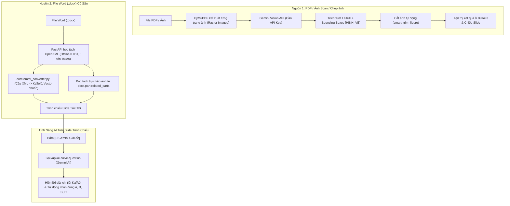

# 📐 Math OCR Tool & Trình Chiếu Đề Toán — Hồ Sơ Dự Án Toàn Diện (TEST-2)

> **Tài liệu bàn giao & Tổng kết dự án**: Dành cho người dùng và các phiên làm việc tiếp theo (New Chat). Đọc file này để nắm trọn vẹn kiến trúc, tính năng, mã nguồn và các lưu ý kỹ thuật mà không cần đọc lại lịch sử chat cũ.

---

## 1. Mục Tiêu Dự Án
1. **Chuyển đổi Đề thi Toán học tiếng Việt**: Từ **PDF / Ảnh scan / Ảnh chụp / Clipboard (Ctrl+V)** sang file **Word (.docx)** chứa công thức Toán học chuẩn **OMML (Word Native Equation)**, bảo toàn cấu trúc đề thi, không dính báo cáo AI thừa.
2. **Tự động Bóc tách & Nhúng Hình ảnh**: Nhận diện tọa độ đồ thị hàm số, hình học không gian, bảng biến thiên; tự động cắt sát nét bằng thuật toán thông minh (`smart_trim_figure`) và nhúng trực tiếp vào Word tại đúng câu hỏi.
3. **Macro VBA Chuẩn Hóa File Word (Dự án 1)**: Cung cấp mã VBA 1-click để thầy cô làm đẹp file Word ngay lập tức (căn lề A4 chuẩn Nghị định 30, font Times New Roman 12pt, giãn dòng 1.15, in đậm có chọn lọc Câu 1: A. B. C. D., căn giữa ảnh và bảng biểu, bảo toàn font Cambria Math của công thức).
4. **Hệ Thống Trình Chiếu Slide Thay Thế PowerPoint (Dự án 2)**: Trình chiếu từng câu hỏi (1 câu = 1 slide) siêu nhẹ, siêu mượt 60 FPS, không cần cài PowerPoint nặng máy:
   - Chiếu trực tiếp từ web sau khi OCR (có đủ ảnh và công thức).
   - Nạp trực tiếp file Word (`.docx`) sẵn có từ máy: Web tự động bóc tách cả công thức và **100% hình ảnh trong file Word** lên slide.
   - **Tích hợp Gemini AI giải đề trực tiếp trên slide**: Bấm nút `[🤖 Gemini Giải đề]` để AI giải chi tiết từng bước bằng KaTeX và tự động tô xanh đáp án đúng $A, B, C, D$.
   - Xuất file **Slide Offline (.html)** tự chạy độc lập không cần Internet.

---

## 2. Cấu Trúc File & Thư Mục Dự Án

```
d:\TU HOC VIBE CODE\TEST-2\
├── app.py                                # Backend FastAPI (OCR, Cắt ảnh, Xuất Word, Parse docx, AI Solve)
├── Dockerfile                            # Tệp đóng gói Container Python 3.12-slim chạy độc lập trên Cloud/Render
├── requirements.txt                      # Danh sách thư viện chuẩn cho môi trường Cloud
├── .gitignore                            # Bảo vệ API Key .env và ngăn file rác temp_output đẩy lên GitHub
├── core/
│   ├── word_exporter.py                  # Bộ xuất Word lõi (LaTeX -> MathML -> OMML, nhúng ảnh chuẩn A4)
│   ├── omml_converter.py                 # Bộ giải mã đệ quy OMML XML Word -> LaTeX & chuẩn hóa vectơ
│   ├── pdf_native_extractor.py           # Bóc tách ảnh Bitmap & Vector Drawing PDF 300 DPI chống đen
│   └── MML2OMML.XSL                      # File chuyển đổi MathML -> OMML chuẩn Microsoft nhúng trực tiếp
├── templates/
│   ├── index.html                        # Giao diện Web 3 bước + Hệ thống Slide Viewer Trình chiếu tích hợp AI
│   ├── presenter.html                    # Giao diện Màn hình Giáo viên (Presenter View 2 màn hình HDMI)
│   └── offline_presentation.html         # Template Slide Offline (.html) xuất file độc lập không cần Internet
├── static/
│   └── vendor/                           # Thư viện cục bộ chạy 100% Offline không cần Wi-Fi (KaTeX + 20 fonts, Cropper.js)
├── vba_source/
│   └── ChuanHoaDeToan.bas                # Macro VBA chuẩn hóa đẹp file Word 1-click
├── prompts/
│   └── quiz_prompt.txt                   # Prompt chuẩn hóa cấu trúc đề thi trắc nghiệm & tự luận
├── .env                                  # Cấu hình GEMINI_API_KEY ở môi trường Localhost
├── PROJECT.md                            # Hồ sơ dự án toàn diện (File này)
└── temp_output/                          # Thư mục lưu phiên làm việc, ảnh gốc và ảnh đã cắt (autocrop)
```

---

## 3. Kiến Trúc & Nguồn Dữ Liệu: PDF vs Word (.docx)

Một trong những câu hỏi cốt lõi khi vận hành hệ thống là: **Dữ liệu lấy từ đâu và khi nào cần đến Gemini API?**



| Tiêu chí so sánh | Nguồn 1: PDF / Ảnh Scan | Nguồn 2: File Word (.docx) |
|---|---|---|
| **Bản chất dữ liệu** | Là ảnh phẳng (raster pixels), máy tính không biết chữ hay công thức ở đâu. | Đã là cấu trúc số hóa (văn bản XML, công thức OMML, file ảnh gốc đính kèm). |
| **Vai trò của Gemini AI** | **Bắt buộc**: Dùng Gemini Vision đọc chữ toán học thành LaTeX và tìm toạ độ hình vẽ/bảng biểu. | **Tùy chọn**: Đọc file cực nhanh (0.05s) không tốn token. Chỉ gọi Gemini AI khi bấm **`[🤖 Gemini Giải đề]`**. |
| **Tốc độ nạp dữ liệu** | 5 – 15 giây / trang tùy tốc độ mạng và số lượng API Key. | **Gần như tức thì (~0.05 giây)** cho toàn bộ 50 câu hỏi. |
| **Hiển thị trên Slide** | Huy hiệu: `⚡ Động cơ: Gemini AI` | Huy hiệu: `⚡ Động cơ: Word Native (0.05s)` |

---

## 4. Chi Tiết Tính Năng Cốt Lõi Đã Hoàn Thiện 100%

### A. Pipeline Chuyển Đổi Toán Học (PDF/Ảnh $\rightarrow$ Word OMML)
- **Model AI**: Mặc định dùng `gemini-3.8-flash` (nhanh, chuẩn công thức). Hỗ trợ dropdown 5 model linh hoạt và cơ chế tự động thử lại khi gặp 429/503.
- **Quản lý Multi-API Key & Xử lý Song Song**: Cho phép nhập nhiều API Key trên web (lưu `localStorage`) hoặc cấu hình qua `.env`. Tự động chạy song song 2-3 trang cùng lúc khi có nhiều key, tự động chuyển key khi chạm hạn mức.
- **Công thức Toán Native OMML**:
  - Chuyển đổi qua chuỗi: `LaTeX -> MathML -> OMML`.
  - Xử lý triệt để lỗi ô vuông đứt nét trước số âm: bọc `{-2}`, ép thuộc tính `form="prefix"` cho thẻ `<mo>` trong MathML, lọc bỏ 100% `<m:e>` rỗng trong OMML XML.
  - Tự động bọc các ký hiệu toán học đơn lẻ ($A, B, C$, $Ox, Oy, Oz$, toạ độ $M(a; b; c)$, tam giác $ABC$, vectơ $\vec{u}$...) vào native Equation.
- **In đậm có chọn lọc (Selective Bolding)**: Chỉ in đậm đúng từ khóa nhãn câu (`Câu 1:`, `Bài 1:`) và nhãn trắc nghiệm (`A.`, `B.`, `C.`, `D.`). Không bao giờ in đậm cả đoạn đề bài.
- **Bảo vệ phương án `A.` trắc nghiệm**: Ngắt dòng riêng cho các phương án `A., B., C., D.`, chặn đứng lỗi AI nhận nhầm `điểm A.` thành `$A$.` làm nuốt nhãn vào Equation.
- **Nối từ ngắt dòng sai từ OCR (`join_broken_ocr_lines`)**: Ghép lại các từ bị ngắt dòng ngang chữ (như `chụ\nc)` $\rightarrow$ `chục)`).
- **Xuất thuần túy 100% nội dung đề thi**: Đã gỡ bỏ 100% bảng checklist AI thừa.

### B. Cơ Chế Bóc Tách & Nhúng Hình Ảnh / Bảng Biến Thiên
- **Phân định rạch ròi giữa Hình vẽ và Bảng**:
  - Với thẻ `[HÌNH_VẼ: ...]`: Thuật toán trim chỉ xén khoảng trắng thừa 4 phía ngoài cùng và thêm lề 5px; bảo toàn tuyệt đối 100% các đỉnh $A, B, C, D, A', B', C', D'$ của hình học không gian và hệ trục tọa độ $Oxyz$.
  - Với thẻ `[BẢNG: ...]`: Nhận diện đường kẻ viền bảng thực tế qua `max_run >= W * 0.30`. Cắt thẳng từ viền trên trở xuống để loại bỏ 100% dòng chữ đề bài phía trên, cắt thẳng tại viền dưới để loại 100% chữ phương án phía dưới. Khi chiếu Slide, bảng được tự động nhận diện `isTable: true` để căn chỉnh vừa khít khung nhìn, không bao giờ làm xô lệch các cột số liệu.
- **Cơ chế Hybrid Waterfall 2 Nhánh Thông Minh**:
  - **Ưu tiên 1A (Ảnh Bitmap nhúng gốc)**: Bóc tách trực tiếp ảnh XObject PNG/JPEG từ PDF (100% nét căng như Foxit PDF).
  - **Ưu tiên 1B (Cụm Vector Drawing 300 DPI)**: Tự động gom cụm các nét vẽ vector (`page.get_drawings()`) cho đồ thị/hình học không gian/bảng biểu và kết xuất tại độ phân giải in ấn 300 DPI, đệm an toàn 5pt bảo toàn trọn vẹn nhãn $A, B, C, O, x, y$.
  - **Luồng Fallback an toàn**: Nếu là bản scan toàn trang hoặc ảnh chụp -> Tự động chuyển 100% sang luồng AI Vision Bounding Box + `smart_trim_figure`.
- **Hệ Thống Huy Hiệu Nổi Bật Nguồn Gốc Ảnh**:
  - Hiển thị trực quan trên Kho ảnh (Bước 3), Xem trước KaTeX và Trình chiếu Slide:
    * `💎 Ảnh gốc PDF`: Ảnh bitmap nguyên bản nhúng trong PDF (100% nét).
    * `📐 Vector PDF`: Cụm nét vẽ Vector Drawing kết xuất 300 DPI nguyên bản.
    * `📊 Bảng biểu`: Bảng biến thiên / Bảng số liệu cắt sát viền.
    * `🤖 AI Vision (Scan)`: Ảnh cắt từ trang scan bằng AI Vision Bounding Box.
- **Quy tắc Bounding Box chống cắt lẹm nhánh trái đồ thị**: AI bắt buộc nhận diện điểm cao nhất (Cực đại) và điểm thấp nhất (Cực tiểu); kéo mép trái `xmin` bao trọn vùng âm $x < 0$ (không lấy trục $Oy$ làm mép trái); cộng đệm an toàn 15–25 đơn vị trên thang 0–1000.
- **Lưới bảo hiểm chống ảo giác toàn trang**: Cấm AI xuất thẻ hình vẽ cho toàn bộ trang scan hoặc khi trang không có hình. Backend và Frontend tự động hủy bỏ mọi thẻ có diện tích > 55% hoặc chứa từ khóa rác.
- **Chuẩn hóa kích thước ảnh khi chèn vào Word**: Tự động điều chỉnh chiều cao trong khoảng `3.5 cm` đến `4.5 cm` theo aspect ratio, khống chế chiều rộng max `15.5 cm` (vừa vặn lề in A4), không bao giờ in caption chữ thô bên dưới ảnh.
- **Modal Cắt thủ công (Cropper.js)**: Tự động zoom và focus tâm nhìn vào vật thể, kéo 4 góc mượt mà, nút "Lưu vùng cắt" cập nhật trực tiếp vào file Word.
- **Kho ảnh & Tải về**: Hiển thị toàn bộ hình ảnh đã nhận diện ở Bước 3, có nút tải từng ảnh và nút tải trọn bộ file `.zip`.

### C. Dự Án 1: Macro VBA Chuẩn Hóa Word 1-Click (`vba_source/ChuanHoaDeToan.bas`)
File VBA được lưu sẵn tại: [vba_source/ChuanHoaDeToan.bas](file:///d:/TU%20HOC%20VIBE%20CODE/TEST-2/vba_source/ChuanHoaDeToan.bas).
- **Căn lề A4 Nghị định 30/2020/NĐ-CP**: Trên 2cm, Dưới 2cm, Trái 3cm, Phải 2cm.
- **Font & Đoạn văn**: Times New Roman 12pt, giãn dòng 1.15, cách đoạn After 3pt, căn đều hai bên (Justify).
- **Bảo toàn công thức Toán**: Không ghi đè font lên các khung công thức `OMML`, giữ nguyên định dạng font toán `Cambria Math`.
- **Làm sạch văn bản**: Xóa dấu cách thừa, xóa dòng trống dồn dập, sửa lỗi khoảng cách trước dấu câu (` .`, ` ,`, ` :`, ` ;`).
- **In đậm có chọn lọc**: Tìm và in đậm `Câu 1:`, `Câu 1.`, `A.`, `B.`, `C.`, `D.`.
- **Căn giữa hình ảnh và bảng biểu**: Căn giữa toàn bộ `InlineShapes` và `Tables`, tự co nhỏ ảnh nếu vượt quá 15.5cm.
- **Cách dùng cho thầy cô**: Mở Word $\rightarrow$ `Alt + F11` $\rightarrow$ Insert Module $\rightarrow$ Dán code $\rightarrow$ Gán nút 1-click trên Quick Access Toolbar.

### D. Dự Án 2: Hệ Thống Trình Chiếu Slide Thay Thế PowerPoint (Web Slide Viewer)
- **Truy cập cực kỳ linh hoạt (Hỗ trợ 3 nguồn dữ liệu)**:
  1. *Chiếu trực tiếp sau OCR (Bước 3)*: Bấm nút **`[🎬 Trình chiếu Slide]`** cạnh nút Xuất Word $\rightarrow$ Hệ thống tự động chia slide theo từng câu, hiển thị đầy đủ công thức KaTeX và hình ảnh/bảng biến thiên đã cắt.
  2. *Chiếu từ File Word (.docx) có sẵn*: Bấm nút **`[🎬 Trình Chiếu Slide Đề Toán]`** ở đầu trang $\rightarrow$ Bấm **`[📁 Nạp file Word (.docx)]`** $\rightarrow$ Hệ thống tự động bóc tách toàn bộ công thức và **trích xuất 100% hình ảnh trong file Word** gắn vào từng slide siêu tốc 0.05s!
  3. *Chiếu từ File PDF*: Bấm nút **`[🎬 Trình Chiếu Slide Đề Toán]`** $\rightarrow$ Bấm **`[📑 Nạp file PDF (Qua AI)]`** $\rightarrow$ Hệ thống tự động nạp file PDF vào pipeline OCR nhận diện của Gemini AI, sau khi quét xong sẽ mở trình chiếu tức thì.
  4. *Trình chiếu nhanh từ văn bản*: Cho phép copy & paste trực tiếp văn bản đề thi vào khung để chiếu ngay.
- **Bộ tính năng phục vụ giảng dạy lớp học**:
  - **1 Câu = 1 Slide**: Tự động nhận diện `Câu 1, Câu 2...`, hiển thị chữ to rõ (font 24-42pt), công thức KaTeX sắc nét vector, phóng to không vỡ hình.
  - **Giải mã toàn diện Equation OMML từ file Word (`core/omml_converter.py`)**:
    * Chuyển đổi đệ quy cây OMML sang LaTeX: bảo toàn 100% phân số `\frac{...}{...}`, số mũ `x^2`, `x^3`, căn thức `\sqrt{...}`, và dấu vectơ `\vec{...}` (không còn bị rớt phân số thành `x-1x+1` hay rớt số mũ thành `x2+3x+1`).
    * Chuẩn hóa tự động mọi biến thể vectơ: `B'D'→`, `A'C'→`, `DB→`, `u→`, `A'A→` hoặc `B'D'\vec` $\rightarrow$ chuyển hóa thành chuẩn KaTeX `$\vec{...}$` có mũi tên trên đầu.
  - **Bảo tồn vị trí xuất hiện tự nhiên của Hình ảnh / Bảng biến thiên (Inline Placeholder)**:
    * Dùng placeholder `___PRES_IMAGE___` giữ ảnh/bảng đúng vị trí xuất hiện ban đầu (nằm giữa lời dẫn đề bài và câu hỏi kết luận).
    * Loại bỏ hoàn toàn lỗi ném ảnh xuống đáy tạo khoảng trắng lớn hốc hác ở giữa slide (như đã sửa ở Câu 3 và Câu 7).
  - **Bố cục 2 Cột Đột Phá Cho Khổ Màn Hình 16:9 (Split-Layout: Đề Trái — Hình Phải)**:
    * Khi câu hỏi có kèm Hình vẽ / Đồ thị / Bảng biến thiên, màn hình tự động chia làm 2 cột:
      - **Cột Trái (58% width)**: Chứa Header, Thân đề bài dẫn, và 4 phương án $A, B, C, D$.
      - **Cột Phải (42% width)**: Chứa Hình vẽ được căn giữa, phóng to tối đa theo chiều dọc lên đến **`70vh`** (thay vì bị bẹp dí 30vh như bố cục cũ).
    * **Zero-Scroll (Tuyệt đối không sinh thanh cuộn)**: Khai thác trọn vẹn chiều ngang của màn chiếu lớp học, toàn bộ câu hỏi và đồ thị nằm vừa khít 1 khung nhìn (100vh).
    * **Nút bấm 1-click & Phím tắt `C`**: Nút `[🖼️ 2 Cột: Bật/Tắt]` trên thanh công cụ cho phép thầy cô linh hoạt chuyển đổi giữa 2 cột song song và 1 cột xếp chồng truyền thống.
  - **Phóng to Ảnh Trực Tiếp & Bộ Công Cụ Tương Tác Sư Phạm (Pop-Zoom)**:
    * **Bỏ làm đen nền phía sau**: Lớp backdrop được chuyển sang trong suốt, không làm đen hay mờ đề bài phía sau, giúp người dạy và học sinh vừa soi chi tiết ảnh vừa đối chiếu rõ ràng với đề bài và các lựa chọn trắc nghiệm xung quanh.
    * **Mặc định bung to Cực đại (94% màn hình máy chiếu)**: Khi bấm phóng to ảnh hoặc bảng, hệ thống ép kích thước theo màn chiếu Viewport `width: min(94vw, 1420px)`, bung to khổng lồ chiếm 94% bề ngang màn hình lớp học, bất kể ảnh gốc cắt ra nhỏ 200px hay 300px; học sinh ngồi bàn cuối vẫn nhìn rõ từng con số, dấu $+/-$. Người dùng có thể bấm `➖` để thu nhỏ bớt (80% ➔ 65% ➔ 50%) nếu cần hoặc bấm `↺ Cực đại` để bung to trở lại.
    * **Bút vẽ (Pen) & Dạ quang (Highlight) trực tiếp lên ảnh phóng to**:
      - Tích hợp Canvas tương tác bám tọa độ 1:1 theo ảnh phóng to.
      - Hỗ trợ công cụ `✏️ Bút vẽ` (nét mảnh viết số, vẽ chiều biến thiên, khoanh nghiệm) và `🖍️ Highlight` (nét dạ quang trong suốt tô sáng khoảng số liệu/biến thiên).
      - Hỗ trợ nút `🎨 Đổi màu` (Vàng, Đỏ, Xanh lam, Xanh lá, Tím) và `🧹 Xóa nét`.
      - Hỗ trợ đầy đủ chuột, bút stylus bảng vẽ điện tử (Wacom/Huion) và màn hình cảm ứng tương tác.
  - **Tự Động Cân Chỉnh Vị Trí Bảng vs Hình Vẽ (Smart Adaptive Placement)**:
    * **Bảng biểu & Bảng số liệu nằm ở DƯỚI câu hỏi**: Tự động nhận diện bảng biến thiên, bảng xét dấu, bảng số liệu ghép nhóm và ảnh tỉ lệ ngang rộng $\rightarrow$ luôn được xếp ở vị trí tự nhiên phía DƯỚI câu hỏi (giữa đề bài và các phương án $A, B, C, D$) với độ rộng full-width tối đa lên tới 960px, không bị ép co rúm hẹp sang phải, các cột số liệu thẳng hàng sắc nét.
    * **Chỉ chia 2 cột với Hình to**: Chỉ những hình học không gian, đồ thị hàm số có kích thước lớn hoặc dạng dọc/vuông mới được chia 2 cột sang bên cạnh (`pres-split-right`) để tận dụng tối đa không gian 16:9.
    * **Thanh nút ảnh mờ thông minh**: Nút `🔍 Phóng to` và `✂️ Cắt lại` được đưa lên góc trên với độ mờ tự động, chỉ sáng bừng lên khi rê chuột, không bao giờ che khuất số liệu bảng.
  - **Zoom Chữ Thoải Mái (Không Bị Giới Hạn Trần 48px)**:
    * Nâng trần cỡ chữ thủ công lên tới **100px** qua nút `A+` / phím tắt `+` / `=` để thầy cô có thể phóng chữ to khổng lồ tùy ý cho các hội trường hoặc phòng học lớn.
    * Khung câu hỏi tích hợp cơ chế cuộn mượt tự động khi phóng to cực đại, đảm bảo chữ không bao giờ bị cắt cụt.
  - **Công Cụ Cắt Lại Ảnh Trực Tiếp Trên Slide (In-Slide Recrop Tool)**:
    * Cho phép giáo viên khoanh vùng cắt lại ngay trên slide nếu ảnh bị thừa viền, lệch khung hoặc không như ý muốn mà không cần thoát trình chiếu hay làm lại từ đầu.
  - **Bố cục đáp án thông minh (Smart Choice Layout) & Chống gãy dòng công thức**:
    * **Tự động nhận diện**: Đáp án ngắn $\rightarrow$ 4 cột ngang; Đáp án chứa phân số hoặc công thức dài $\rightarrow$ tự động chia **2 trên 2 dưới (2x2)**; Đáp án câu văn dài $\rightarrow$ 4 dòng riêng biệt dọc.
    * **Nút bấm 1-click `[⊞ Bố cục]`**: Cho phép giáo viên chủ động xoay vòng: `Tự động` $\leftrightarrow$ `2x2` $\leftrightarrow$ `4 Dọc` $\leftrightarrow$ `4 Ngang`.
    * Thêm `white-space: nowrap` cho công thức toán trong đáp án để không bao giờ bị bẻ gãy phép tính giữa chừng.
  - **Cơ chế Auto-Scale Phóng to Cực đại (Max Zoom khi Fullscreen)**:
    * Tự động điều chỉnh kích thước font chữ dựa trên chiều cao màn hình và độ dài nội dung từng câu.
    * Với câu ngắn (như Câu 5): Tự động phóng to lên **36px – 42px**, lấp đầy màn hình vừa vặn, uy nghi, học sinh bàn cuối nhìn cực rõ!
    * Với câu có kèm hình vẽ: Giới hạn chiều cao ảnh `max-height: 38vh`, font chữ từ **24px – 28px** để bảo đảm trọn vẹn trong 1 trang chiếu, không sinh thanh cuộn.
    * Có nút gạt **`[⚡ Cực đại]`** trên thanh công cụ để bật tắt nhanh chế độ siêu to.
  - **Trí tuệ nhân tạo Gemini Giải đề tức thì (`[🤖 Gemini Giải đề]`)**:
    * Tích hợp trực tiếp trên thanh công cụ slide với nhãn hiển thị số lượng API Key sẵn sàng: `[🤖 Gemini Giải đề 🔑 2 Key]`.
    * Bấm 1 chạm $\rightarrow$ Gemini AI phân tích câu hỏi, trình bày lời giải chi tiết chuẩn mực sư phạm với công thức LaTeX và **tự động xác định phương án đúng** (tô xanh đáp án A/B/C/D).
  - **Ẩn / Hiện Đáp án & Lời giải (Phím `Space` hoặc `A`)**: Mặc định ẩn đáp án để học sinh suy nghĩ; bấm `Space` phương án đúng tự động đổi sang màu xanh lá `emerald` và bung khung lời giải chi tiết.
  - **Hỗ trợ Bút trình chiếu Laser (Clicker)**: Nhận các phím chuẩn: `PageDown` / `Mũi tên phải` / `Space` (sang câu); `PageUp` / `Mũi tên trái` (về câu trước); `B` (tạm tắt màn hình đen khi giảng bài).
  - **Bút vẽ bảng ghi chú (Phím `P` hoặc nút `✏️`)**: Thầy cô dùng chuột hoặc bảng vẽ điện tử vẽ trực tiếp, gạch chân từ khóa, khoanh tròn đồ thị ngay trên slide; có nút `🗑️ Xóa nét`.
  - **Bút Laser ảo (Phím `L` hoặc nút `🔴`)**: Con trỏ chuột biến thành đốm đỏ phát sáng theo dõi vị trí giảng bài.
  - **3 Giao diện học đường (🎨)**: Chế độ **Bảng Phấn (Chalkboard)** chữ trắng trên nền xanh rêu chống mỏi mắt $\leftrightarrow$ **Bảng Trắng (Whiteboard)** cho phòng học ban ngày $\leftrightarrow$ **Nền Tối (Dark Slate)**.
  - **Xuất File Slide Offline (.html)**: Đóng gói toàn bộ câu hỏi, công thức KaTeX, bố cục 2x2, ảnh Base64 và thuật toán Auto-Fit vào **1 file HTML duy nhất**. Thầy cô chép vào USB mang đến trường không có mạng vẫn chiếu mượt mà 60 FPS!

---

## 5. Hướng Dẫn Vận Hành Hệ Thống

### 1. Khởi động Web Tool:
- **Cách 1 (Dùng trên máy cá nhân)**:
  Mở terminal tại thư mục dự án và chạy:
  ```powershell
  python app.py
  ```
  Sau đó mở trình duyệt truy cập: `http://localhost:8000`.
- **Cách 2 (Chia sẻ link online cho bạn bè dùng chung)**:
  Chạy file `BAT_ONLINE.bat`, đợi 3 giây và copy đường link Cloudflare dạng `https://...trycloudflare.com` gửi cho bạn bè.

### 2. Sử dụng Macro VBA trong Word:
- Mở file Word xuất từ tool $\rightarrow$ Nhấn `Alt + F11` $\rightarrow$ Insert Module $\rightarrow$ Dán nội dung từ [vba_source/ChuanHoaDeToan.bas](file:///d:/TU%20HOC%20VIBE%20CODE/TEST-2/vba_source/ChuanHoaDeToan.bas) $\rightarrow$ Nhấn `F5` để chạy.

---

## 6. Danh Mục Các API Endpoint Backend (`app.py`)

| Endpoint | Method | Chức năng chính |
|---|---|---|
| `/` | `GET` | Render trang chủ giao diện web (`templates/index.html`). |
| `/api/config-keys` | `GET` | Lấy danh sách số lượng API Key đã nạp sẵn trong file `.env`. |
| `/api/upload` | `POST` | Upload file PDF hoặc ảnh, tạo phiên làm việc `session_id`, render trang scan qua PyMuPDF. |
| `/api/ocr-stream` | `POST` | Chạy OCR đa luồng gọi Gemini Vision API (SSE stream kết quả từng trang). |
| `/api/crop` | `POST` | Cắt lại ảnh thủ công bằng toạ độ Cropper.js. |
| `/api/download-figures/{session_id}` | `GET` | Tải về file ZIP chứa 100% hình ảnh đã bóc tách của đề thi. |
| `/api/parse-docx-file` | `POST` | Đọc file Word (.docx), giải mã OMML sang LaTeX và trích xuất 100% ảnh nhúng sang Base64 cho Trình chiếu Slide. |
| `/api/ai-ocr-question` | `POST` | Dùng Gemini AI đọc lại, sửa lỗi công thức KaTeX ($...$) và chuẩn hóa câu hỏi toán học (OCR / Math Fallback). |
| `/api/ai-solve-question` | `POST` | Dùng Gemini AI giải chi tiết bài toán và tự động nhận diện đáp án trắc nghiệm đúng ($A, B, C, D$). |
| `/api/export-slide-offline` | `POST` | Đóng gói toàn bộ slide kèm ảnh Base64 thành file HTML độc lập trình chiếu offline không cần mạng. |
| `/api/export-docx` | `POST` | Đóng gói và xuất file Word (.docx) chứa công thức chuẩn OMML Native và hình ảnh nhúng chuẩn A4. |

---

## 7. Bảng Rà Soát 37 Lỗi Đã Giải Quyết Triệt Để (Lưu Ý Bắt Buộc Giữ)

| STT | Tên lỗi đã xử lý | Hiện tượng trước đây | Giải pháp đã chuẩn hóa (KHÔNG ĐƯỢC PHÁ VỠ) |
|---|---|---|---|
| **1** | **Mất ảnh Câu 1 khi xuất Word** | Câu 1 có ảnh trên web nhưng file Word không có | Hỗ trợ cả 2 định dạng thẻ (có/không có `question=`); cô lập thẻ hình ảnh thành 1 paragraph độc lập; bổ sung fallback tự nạp ảnh từ `session_dir`. |
| **2** | **Câu 2 mất phương án `A.` & dính caption** | Dưới ảnh hiện caption thô, mất phương án `A.` | Xóa bỏ 100% caption dưới ảnh trong Word; luôn tách `A.` ra dòng riêng và parse tiếp phần text sau dấu `]`. |
| **3** | **Từ bị ngắt dòng sai từ OCR (`chụ\nc)`)** | Chữ `chục)` bị tách đôi, `c)` biến thành ý trắc nghiệm mới | Thêm hàm `join_broken_ocr_lines` nối lại từ trước khi tách đoạn nếu dòng trước không có dấu chấm câu. |
| **4** | **Ô vuông đứt nét trước số âm trong Equation** | Các số âm như $-2$ bị dính ô vuông rỗng | Hàm `wrap_negative_numbers` bọc `{-2}`, ép thuộc tính `form="prefix"` cho thẻ `<mo>` trong MathML, lọc bỏ toàn bộ phần tử `<m:e>` rỗng trong OMML. |
| **5** | **Model cũ bị Google khai tử (Lỗi 404)** | Gọi API Gemini báo lỗi model không tồn tại | Đổi model mặc định sang `gemini-3.8-flash`; tích hợp `_generate_content_with_retry` tự động fallback qua các model dự phòng. |
| **6** | **Nút "Cắt lại" bị lỗi cú pháp JS** | Nhấn "Cắt lại" trên kho ảnh ở Bước 3 không mở được modal | Chuyển toàn bộ sự kiện mở modal cắt sang gọi hàm qua index: `openCropFromGallery(idx)` và `openCropFromToken(pageIdx, tokIdx)`. |
| **7** | **Cắt lẹm nửa bên trái đồ thị hàm số & cụt bảng** | Bounding box mất nhánh trái ($x < 0$), mất điểm cực đại âm ($x = -1, y = 3$) | Bắt buộc nhận diện điểm cao nhất/thấp nhất; `xmin` bắt buộc kéo trọn sang vùng âm $x < 0$; cộng đệm an toàn 15–25 đơn vị trên thang 0–1000. |
| **8** | **Kích cỡ ảnh trong Word bị quá to/tràn lề** | Ảnh nhúng vào Word bị tràn lề in A4 | Chuẩn hóa `insert_image_into_doc`: tự động điều chỉnh chiều cao trong khoảng `3.5 cm` đến `4.5 cm` theo aspect ratio, khống chế chiều rộng max 15.5cm. |
| **9** | **Phương án `A.` dính vào cuối câu dẫn (`...tại điểm A.`)** | `A` bị in nghiêng bên trong Equation, mất nhãn `A.` | Tích hợp hàm `normalize_choice_structure` bóc tách `A. ... B. ... C. ... D. ...` ra khỏi `$`, `**` và ngắt dòng riêng; định dạng `A., B., C., D.` là chữ thường in đậm ngoài Equation. |
| **10** | **Regex làm sạch text đâm xuyên làm rách thẻ ảnh** | Ảnh không chèn vào Word, bị in nguyên văn text thô `[HÌNH_VẼ: ...]` | Thiết lập nguyên tắc **Masking First**: bọc thẻ bằng token ẩn trước khi dọn text; parser bổ sung fallback `tag_pattern_tolerant` chịu lỗi mất ngoặc `]`. |
| **11** | **AI nhận nhầm toàn bộ trang scan thành hình ảnh** | Toàn bộ trang scan bị cắt và nhồi vào kho ảnh như một hình vẽ khổng lồ | Thiết lập **Lưới bảo hiểm Guardrails kép**: Prompt cấm xuất thẻ toàn trang scan; backend và frontend tự động hủy bỏ mọi thẻ có diện tích > 55% hoặc chứa từ khóa rác. |
| **12** | **Lỗi Vectơ, Mất phân số OMML, Khoảng trắng ảnh & Chữ bé khi Fullscreen** | Vectơ thành `B'D'\vec`, phân số thành `x-1x+1`, ảnh/bảng bị ném xuống đáy tạo khoảng trắng lớn, chữ bé khi Fullscreen | 1. Xây dựng bộ `core/omml_converter.py` chuyển đổi đệ quy OMML -> LaTeX bảo toàn phân số, số mũ, căn, vectơ; tự động sửa `B'D'→`, `u→` thành `\vec{...}`.<br/>2. Bảo tồn vị trí xuất hiện tự nhiên của ảnh/bảng bằng placeholder `___PRES_IMAGE___` inline.<br/>3. Bố cục đáp án thông minh tự chia 2x2 (2 trên 2 dưới) hoặc 4 dòng dọc khi công thức dài; chống bẻ gãy dòng công thức.<br/>4. Tự động tính toán Max Zoom Auto-fit (36px-42px cho câu ngắn như Câu 5) lấp đầy màn hình vừa vặn tuyệt đẹp! |
| **13** | **Giao diện kẹt "Đã nạp 0 API Key", tê liệt toàn bộ sự kiện nút bấm JS** | Backend `.env` có 2 API Key nhưng web hiện "Đã nạp 0 API Key", các tab, nút upload, phím tắt không bấm được | 1. **Nguyên nhân cốt lõi**: File `templates/index.html` bị sót 2 dấu ngoặc nhọn `}` sau khối sự kiện `fullscreenchange` gây lỗi `SyntaxError: Unexpected token '}'`. Trình duyệt dừng hoàn toàn việc chạy JS của trang, khiến `initApiKeyPool()` và `fetch('/api/config-keys')` không bao giờ được kích hoạt, kẹt nguyên text HTML tĩnh ban đầu.<br/>2. **Khắc phục**: Xóa 2 dấu `}` thừa; đổi text placeholder HTML ban đầu thành `Đang kiểm tra API Key...`.<br/>3. **Kinh nghiệm bắt buộc**: Sau mỗi lần refactor hoặc chèn thêm script vào `templates/index.html`, luôn trích xuất và chạy kiểm tra cú pháp tự động (`node --check`) trước khi kết thúc công việc! |
| **14** | **Vectơ và Phân số dạng chữ bị trôi thành text thô khi Xuất Word** | Các vectơ `B'D'\vec`, `u→`, `u→ = A'A→ + A'B'→` và phân số `y = (3x+2)/(x-2)` khi xuất sang Word không thành công thức OMML mà bị in thành text thô, hoặc lỗi fallback sang `<mtext>` | Tích hợp bộ tiền xử lý `sanitize_plain_text_vectors` và chuẩn hóa phân số đại số vào thẳng `core/word_exporter.py` và `app.py`. Mọi biến thể vectơ và phân số dạng text thô đều được tự động chuyển thành LaTeX chuẩn `\vec{...}` và `\frac{...}{...}`, biên dịch thành **100% Native Word OMML Equation** cực đẹp! |
| **15** | **Dấu ngoặc `\left(` và `\left[` bị xé nát thành `\le ft(` và `\le ft[`** | Tọa độ $(-1; 3; -2)$ và khoảng $[-2; 3]$ hiển thị màu đỏ báo lỗi cú pháp KaTeX trên Slide | 1. **Nguyên nhân**: `clean_math_latex` chuẩn hóa khoảng trắng `\\le` thiếu ranh giới `\b` (`re.sub(r'\\le', ...)`), ăn lẹm vào đầu từ `\left` biến thành `\le ft` khiến KaTeX lỗi `\right without \left`.<br/>2. **Khắc phục**: Ép buộc ranh giới từ `\\le\b` và `\\ge\b` trong `clean_math_latex`. Bảo toàn 100% các cặp ngoặc `\left( ... \right)` và `\left[ ... \right]`. |
| **16** | **Dấu Vectơ điểm có phẩy $A'C' \rightarrow$ và $D'B' \rightarrow$ bị văng mũi tên ra sau** | Đáp án $A'C'$ và $D'B'$ hiển thị mũi tên $\rightarrow$ bên phải chữ thay vì mũi tên $\vec{...}$ trên đầu | Mở rộng regex nhận diện cả `\rightarrow`, `\to`, Unicode `→`, và cụm điểm có khoảng trắng/phẩy: `r"([A-Z]['’]*\s*[A-Z]['’]*|[A-Za-z0-9'’]+)\s*(?:\\rightarrow\b|\\to\b|[\u2192→]|\\vec\b)"` $\rightarrow$ tự động xóa dấu cách và bọc chuẩn `\vec{A'C'}`, `\vec{D'B'}` ở cả backend (`omml_converter`, `app.py`) lẫn frontend (`buildSlides`). |
| **17** | **Lỗi câu "đến hàng phần trăm" bị ngắt dòng vô lý & dính chú thích ảnh `| Biểu đồ...]`** | Đề bài bị ngắt đôi xuống dòng giữa chừng sau chữ `đến hàng`, slide dính text chú thích ảnh thô lặp lại 2 lần | 1. **Nguyên nhân**: `sec_pattern` dùng cờ `re.IGNORECASE` khớp nhầm chữ thường `"phần"` trong `"hàng phần trăm"` thành Tiêu đề PHẦN của đề thi và tự chèn `\n\n`.<br/>2. **Khắc phục**: Gỡ bỏ hoàn toàn `re.IGNORECASE` trên `sec_pattern`, bắt buộc theo sau phải là chữ số La Mã / Ả Rập / từ khóa (`PHẦN I`, `PHẦN 1`). Tự động nối lại các câu bị ngắt dòng ngang trước chữ thường; làm sạch triệt để các tàn dư chú thích ảnh thô ở đầu câu hỏi trên Slide Viewer. |
| **18** | **Lỗi Dấu Véc-tơ điểm có phẩy và dính chữ tiếng Việt (`A'\vec{A}`, `A'B' \rightarrow`, `\rightarrowbằng`)** | Véc-tơ biến thành $A'\vec{A}$, $A'B' \rightarrow$, $C'\vec{A}.$, $AC'\rightarrow.$, và mũi tên dính với từ `bằng` (`\rightarrowbằng`) | 1. **Nguyên nhân**: OMML accent bọc lệch chỉ lấy chữ cái đứng sau ($A'\vec{A}$); người soạn dùng mũi tên tách rời; `\rightarrowbằng` dính liền làm regex có `\b` thất bại.<br/>2. **Khắc phục**: Quy tắc gộp véc-tơ đỉnh phẩy `([A-Z]['’]*)\s*\\vec\{([A-Z]['’]*)\} -> \vec{$1$2}`; tách rời `\rightarrow` dính chữ tiếng Việt; nhận diện toàn diện $A'\vec{A} \rightarrow \vec{A'A}$, $A'B' \rightarrow \rightarrow \vec{A'B'}$, $AC' \rightarrow \rightarrow \vec{AC'}$. |
| **19** | **Nhãn phương án A. B. C. D. bị nhỏ tí hon so với công thức KaTeX khi chiếu Slide** | Khi bật Fullscreen hoặc chiếu máy chiếu, thân đề và công thức phóng to 28-36px nhưng nhãn A, B, C, D bị bé tí (~18px) | 1. **Nguyên nhân**: CSS `.pres-choice-badge` bị gán cứng `font-size: 1.15rem` không ăn theo kích thước font động của slide.<br/>2. **Khắc phục**: Chuyển sang kích thước động `font-size: calc(var(--pres-font-size, 24px) * 1.05)`, `min-width: 44px`, `font-weight: 800`, căn giữa dọc hoàn hảo với công thức KaTeX. |
| **20** | **Hình ảnh bảng biểu/đồ thị Word bị cắt bẹp dí, trắng xóa 90% & Dính chữ tổng quát (`50bình`)** | Ảnh bảng số liệu (Câu 8) bị xén cụt chỉ còn dải mỏng hở nửa dòng chữ, bên dưới trắng bệch; chữ `50bình` dính liền | 1. **Nguyên nhân chí mạng**: Chuỗi Base64 của ảnh bị các hàm xử lý text quét qua và chèn khoảng trắng ` ` vào giữa (do nhầm là chữ dính/phép toán). Trình duyệt đọc gặp khoảng trắng liền cắt bỏ 90% dữ liệu ảnh còn lại làm ảnh bị hỏng/trắng xóa!<br/>2. **Khắc phục triệt để bằng Khiên Masking Tổng Quát**: Tích hợp `mask_media_tags` và `unmask_media_tags` cất toàn bộ thẻ ảnh Base64 vào két sắt an toàn trước khi xử lý văn bản ở cả Backend lẫn Frontend.<br/>3. **Tách dính chữ tổng quát**: Tách mọi số đứng trước chữ tiếng Việt `(?<![\^_])(\d+)([a-zA-Zà-ỹÀ-Ỹ]+)` (`50bình` -> `50 bình`, `10người` -> `10 người`); tách cụm 2 chữ hoa đứng trước chữ thường (`BCvuông` -> `BC vuông`).<br/>4. **Duyệt theo thứ tự tự nhiên của Word**: Quét `doc._element.body` theo đúng dòng thời gian (Paragraph trước, Table sau) để bảng số liệu xuất hiện đúng ngay trong câu hỏi tương ứng, không bị trôi xuống đáy file. |
| **21** | **Trình chiếu câu có hình vẽ bị tràn trang 16:9, đè bẹp phương án A-B-C-D** | File Word đẹp nhưng lên màn chiếu bị tràn màn hình, hình đè chữ, học sinh bàn cuối không nhìn rõ, phải cuộn trang liên tục | 1. **Giải pháp Đột phá Bố cục 2 Cột (Split-Layout: Đề Trái - Hình Phải)**: Khi câu hỏi có đồ thị/hình vẽ, màn hình tự động chia đôi (58% bên trái cho Đề bài + Đáp án A-B-C-D; 42% bên phải cho Hình vẽ phóng to cực đại lên đến 70vh).<br/>2. **Không bao giờ sinh thanh cuộn (Zero-Scroll)**: Khai thác triệt để chiều ngang màn hình 16:9, văn bản không bị đè nén, font chữ duy trì từ 26px - 32px to rõ uy nghi.<br/>3. **Phóng to tức thì khi giảng (Pop-Zoom)**: Bấm vào hình vẽ để phóng to 1.35x chính giữa màn hình (nhìn rõ tọa độ/số liệu), bấm lần nữa thu về bình thường.<br/>4. **Linh hoạt tuyệt đối**: Nút bấm `[🖼️ 2 Cột: Bật/Tắt]` (phím tắt `C`) cho phép chuyển đổi tức thì giữa 2 cột song song và 1 cột xếp chồng truyền thống trên cả Web và file Slide Offline. |
| **22** | **Cắt lại ảnh trực tiếp trên Slide (In-Slide Recrop) & Thanh công cụ ảnh nổi** | Ảnh tự động cắt bị lệch khung, dính viền đen hoặc chữ thừa nhưng không có cách sửa trực tiếp khi đang chiếu | 1. **Thanh công cụ ảnh nổi (Image Action Bar)**: Khi hover qua ảnh hoặc xem ảnh trên slide, xuất hiện ngay 2 nút bấm: `[🔍 Phóng to]` và `[✂️ Cắt lại]`.<br/>2. **Thanh điều khiển khi Zoom**: Khi click phóng to 1.35x ra giữa màn hình, ở cạnh dưới cũng xuất hiện nút nổi bật `[✂️ Cắt lại ảnh này]` và `[✕ Thu nhỏ]`.<br/>3. **Cắt thông minh đa nguồn**: Nếu là đề PDF OCR, tự động mở lại trang scan gốc nới rộng khung; nếu là đề Word, cắt trực tiếp trên ảnh Base64 bằng canvas không tốn token mạng.<br/>4. **Cập nhật tức thì (Live Update)**: Bấm lưu là bức ảnh trên slide cập nhật ngay lập tức tại đúng câu đang chiếu, không mất vị trí, không phải tải lại trang. |
| **23** | **Cải tổ Parser Word & Tokenization Toán học theo Chuẩn Azota (Xóa bỏ Regex chồng chéo đoán mò)** | Vectơ bị vỡ mất ngoặc nhọn (`\vecDB`, `\vecBD`, `\vecu`); Dấu phẩy đỉnh bị văng dấu mũ (`ABCD.A'^B'^C'^D'^`, `A'^B^\vec{'}`, `C'^\vecA`); Ký hiệu toán học bị dính chữ (`$B'D' \rightarrow$là`, `(-1; 3; -2)và`) | 1. **Backend OMML Converter (`core/omml_converter.py`)**: Xử lý thẻ `<m:sSup>`: nếu số mũ là dấu phẩy đỉnh (1 hoặc nhiều `'` hoặc `\u2032`), trả về trực tiếp `base'` (ví dụ `A'`, `B'`, `D''`), tuyệt đối không sinh ra `{base}^{'}` hay dấu mũ `^`. Chuẩn hóa toàn bộ Unicode prime về `'` chuẩn.<br/>2. **Backend Parser DOM (`app.py`)**: Tự động chèn khoảng trắng tại ranh giới XML giữa `<m:oMath>` và text run nếu dính chữ tiếng Việt/số; Tách ranh giới Run -> Run dính chữ (`(-1; 3; -2)và` -> `(-1; 3; -2) và`).<br/>3. **Đóng két bảo vệ công thức (Math Tokenization - Chuẩn Azota)**: Mask toàn bộ công thức toán vào token ẩn `@@__MATH_TOKEN_i__@@` trước khi chạy các bộ lọc cấu trúc đề thi, không cho regex văn bản đè lên cú pháp LaTeX.<br/>4. **Frontend Slide (`templates/index.html`)**: Xóa bỏ vĩnh viễn lệnh gỡ ngoặc phá hoại `s.replace(/\{([A-Za-z0-9_']+)\}/g, '$1')`; Xóa bỏ việc lặp regex gây lỗi delimiter `$$`. |
| **24** | **Chuẩn hóa Toàn diện Vectơ trên Slide Trình chiếu (Gộp Accent Word 2 chiều & Mũi tên đứng sau)** | Đề bài và phương án A, D bị rớt mũi tên ra sau (`B'D' →`, `A'C' →`, `D'B' →`); Phương án B và C mũi tên chỉ bọc 1 chữ cái đầu hoặc sau (`\vec{D}B`, `\vec{B}D`, `B\vec{D}`) | 1. **Gộp Accent Word bị lệch 2 chiều**: Cả chiều 1 (accent ở chữ đầu `\vec{D}B` -> `\vec{DB}`, `\vec{B}D` -> `\vec{BD}`) và chiều 2 (accent ở chữ sau `B\vec{D}` -> `\vec{BD}`, `D\vec{B}` -> `\vec{DB}`).<br/>2. **Chuyển hóa mũi tên đứng sau**: Tự động nhận diện và chuyển hóa `B'D' →`, `A'C' →`, `D'B' →`, `u→` thành `\vec{B'D'}`, `\vec{A'C'}`, `\vec{D'B'}`, `\vec{u}` cả bên trong lẫn bên ngoài cặp dấu `$`.<br/>3. **Chống Double Dollar**: Đảm bảo các phương án trắc nghiệm inline chỉ dùng đúng 1 cặp dấu `$`, tuyệt đối không sinh ra `$$\vec{BD}$$`. |
| **25** | **Nuốt hệ số vô hướng véc-tơ số học ($-2\vec{j}$ biến thành $\vec{2}{j}$) trong Word Exporter** | Biểu thức $-2\vec{j} + 3\vec{k}$ khi chuyển sang OMML Word bị biến thành $-\vec{2}{j} + \vec{3}{k}$ (dấu mũi tên trùm lên số 2 và số 3) | 1. **Nguyên nhân cốt lõi**: `clean_latex_math` trong `core/word_exporter.py` dùng regex `r"([A-Za-z0-9'’]+)\\vec(?![a-zA-Z])"`, nuốt luôn số `2` đứng trước `\vec` vì `{` không phải là chữ cái.<br/>2. **Khắc phục**: Cấm số `0-9` trong tên véc-tơ `(?:[A-Z][']*(?:\s*[A-Z][']*)+|[a-z][']*)`; thêm negative lookbehind `(?<![\\a-zA-Z0-9])` và cấm ngoặc nhọn mở `(?!\{)` để bảo toàn 100% hệ số vô hướng $-2\vec{j}$, $3\vec{k}$, $2\vec{i}$ và tích vô hướng `\cdot`. |
| **26** | **Kiến trúc Hai Luồng (Dual-Pipeline) & Nạp Word Equation tự động 100% sang `$..$` KaTeX** | File Word OMML tuy đẹp trong Word nhưng lên web phức tạp; cần hỗ trợ đồng thời cả file Word Equation OMML và file Word LaTeX `$..$` | 1. **Tự động hóa 100% khi nạp Word Equation**: Người dùng chỉ cần bấm `[📁 Nạp file Word (.docx)]`, backend tự động nhận diện và dịch đệ quy toàn bộ `<m:oMath>` về `$..$` KaTeX chỉ trong 0.05s mà không cần người dùng thao tác chuyển đổi trước.<br/>2. **Hỗ trợ định dạng Word LaTeX ($..$) kèm ảnh**: Bổ sung nút `[📝 Word (LaTeX $..$)]` ở Bước 3. Xuất file Word giữ trọn 100% ảnh nhúng và công thức `$..$` KaTeX siêu chuẩn.<br/>3. **Nạp file Đề thi LaTeX (.txt / .md)**: Bổ sung nút `[📋 Nạp file Đề thi LaTeX (.txt / .md)]` trên Modal Trình chiếu để mở slide đề thi tức thì 0.005s. |
| **27** | **Trích Xuất Ảnh Gốc Đa Chế Độ (Native PDF Image Extraction & Smart Matching vs Scanned Fallback)** | File PDF bản đẹp (digital PDF) bị cắt lại từ trang render khiến chất lượng giảm, dễ dính mép chữ hoặc cắt lệch so với ảnh gốc nhúng trong PDF (như Foxit PDF đọc ra) | 1. **Mô-đun Native Image Extractor (`core/pdf_native_extractor.py`)**: Tự động bóc tách 100% ảnh nhúng gốc (XObject PNG/JPEG) kèm tọa độ thực `rect` từ PDF khi upload.<br/>2. **Khớp nối Bounding Box Thông Minh**: Khi Gemini OCR đọc câu hỏi có thẻ `[HÌNH_VẼ: box=[...]]`, hệ thống tự động so khớp tọa độ: nếu trùng khớp với ảnh gốc nhúng $\rightarrow$ lấy ngay ảnh gốc chất lượng cao nguyên bản (100% sắc nét, viền khít tuyệt đối, không qua AI crop).<br/>3. **Lưới Phân Loại Tự Động (Auto-Detection)**: Nếu trang chỉ có 1 ảnh chiếm diện tích lớn ($> 40\%$ hoặc chiều ngang $\ge 75\%$) $\rightarrow$ nhận diện là bản Scan $\rightarrow$ tự động kích hoạt fallback 100% về luồng `smart_trim_figure` cũ, bảo toàn tính năng cho mọi loại file scan/chụp ảnh. |
| **28** | **Ảnh nhỏ trong đề thi bị lọt thỏm & Pop-Zoom cố định 1.35x vẫn bé tí** | Hình vẽ trích xuất có kích thước tự nhiên nhỏ (~180px), trình duyệt render giữ nguyên kích thước bé tí; nút Action Bar đè kín ảnh; Pop-Zoom 1.35x chỉ lên 243px vẫn không nhìn rõ | 1. **Tự động bung to vừa vặn cột phải (Auto-Fit Column Width)**: Thiết lập `width: clamp(320px, 94%, 100%)` và `image-rendering: -webkit-optimize-contrast` giúp ảnh nhỏ tự mở rộng cân đối lấp đầy cột 42% mà vẫn sắc nét nét vẽ.<br/>2. **Pop-Zoom Chuẩn Viewport (Không phụ thuộc kích thước ảnh gốc)**: Phóng to theo khung nhìn `width: min(85vw, 860px)`, `max-height: 82vh`, `max-width: 92vw` đảm bảo bung to cực đại rõ ràng từng chi tiết nhưng tuyệt đối không bao giờ vượt quá màn hình.<br/>3. **Bộ Điều Khiển Zoom Trực Tiếp (Zoom Controls & Mouse Wheel)**: Tích hợp nút `➕`, `➖`, `↺ Chuẩn` trên thanh `presZoomPopBar`, cho phép lăn chuột (Mouse Wheel) để phóng to/thu nhỏ linh hoạt từ 60% đến 160%; chuyển thanh công cụ xuống góc dưới không đè lên hình vẽ. |
| **29** | **Bóc tách Ảnh PDF Cơ chế Hybrid Waterfall (Native Bitmap + Vector Drawing 300 DPI vs Fallback Scan)** | Nhiều hình học không gian, đồ thị hàm số và bảng biến thiên trong PDF số hóa được vẽ bằng vector (không có ảnh nhúng bitmap), trước đây bị bỏ lỡ hoặc crop lại từ ảnh render mờ | 1. **Ưu tiên 1A (Ảnh Bitmap gốc)**: Tự động trích xuất ảnh nhúng PNG/JPEG nguyên bản từ PDF.<br/>2. **Ưu tiên 1B (Cụm Vector Drawing 300 DPI)**: Tự động gom cụm các nét vẽ vector (`page.get_drawings()`) thành vùng bounding box logic và kết xuất trực tiếp tại độ phân giải 300 DPI nguyên bản từ chính động cơ vector PDF, đệm an toàn 5pt bảo toàn các chữ nhãn $A, B, C, O, x, y$.<br/>3. **Khớp Bounding Box Thông Minh**: So khớp tọa độ với thẻ `[HÌNH_VẼ]` của Gemini; nếu khớp lấy ngay ảnh gốc (bitmap hoặc vector 300 DPI), không cần cắt thủ công.<br/>4. **Luồng Fallback an toàn 100%**: Nếu là bản scan toàn trang hoặc ảnh chụp -> tự động chuyển mượt sang `smart_trim_figure` trên ảnh render, bảo toàn 100% độ ổn định. |
| **30** | **Chuẩn Hóa Bộ Nấc Zoom Slide Cố Định (75% ↔ 100% ↔ 125% ↔ 150%) & Chặn Trần Tuyệt Đối (Zero-Scroll)** | Phóng to tự do dễ vượt quá chiều cao màn hình, đè mất thanh điều khiển hoặc gây thanh cuộn trang khi chiếu lớp học | 1. **4 Nấc Zoom Cố Định Chuẩn Mực**: `[75%, 100%, 125%, 150%]`, mặc định ở nấc `100%`.<br/>2. **Thao tác Điều khiển Thống nhất**: Nút `➖` lùi nấc, nút `➕` tiến nấc, nút `↺ Chuẩn` về 100%; Con lăn chuột (Mouse Wheel) cuộn lên tăng nấc, cuộn xuống giảm nấc; tự động vô hiệu hóa/mờ nút khi chạm ngưỡng biên (75% hoặc 150%).<br/>3. **Chặn Trần Tuyệt Đối (Zero-Scroll)**: Khống chế kích thước trực tiếp bằng CSS Layout `max-height: min(82vh, calc(68vh * scale))` và `max-width: 92vw`, bỏ `scale(...)` khỏi `transform` để ảnh tuyệt đối không bao giờ vượt quá 82vh và 92vw, không sinh thanh cuộn và không che khuất thanh công cụ nổi `presZoomPopBar`. |
| **31** | **Huy Hiệu Trực Quan Nổi Bật Nguồn Gốc Ảnh & Chuẩn Hóa Nhận Diện Bảng Biểu (Table Recognition)** | Người dùng không biết bức ảnh lấy từ nguồn nào (ảnh gốc PDF, vector drawing hay scan AI crop); bảng số liệu/biến thiên nếu không nhận diện đúng sẽ bị vỡ dòng khi trình chiếu | 1. **Huy Hiệu Trực Quan Đa Tầng**: Tích hợp badge màu riêng biệt trên Kho ảnh Bước 3, Preview KaTeX và Slide Trình Chiếu:<br/>- `💎 Ảnh gốc PDF`: Bitmap nguyên bản nhúng trong PDF (100% nét).<br/>- `📐 Vector PDF`: Cụm nét vẽ Vector Drawing kết xuất 300 DPI nguyên bản.<br/>- `📊 Bảng biểu`: Bảng số liệu / Bảng biến thiên cắt sát viền thực tế.<br/>- `🤖 AI Vision (Scan)`: Cắt từ bản scan bằng AI Vision Bounding Box.<br/>2. **Bảo toàn Bảng Biểu Trình Chiếu (Table Zero-Error)**: Toàn bộ bảng biến thiên và bảng số liệu đều được nhận diện thành thẻ `[BẢNG: ...]` và bóc tách thành hình ảnh phẳng chất lượng cao, nhúng thẳng vào slide (kích hoạt bố cục 2 cột hoặc căn giữa tự động), bảo đảm không bao giờ bị xô lệch cột/hàng số liệu khi trình chiếu. |
| **32** | **Lỗi nuốt dấu `$` của phương án trắc nghiệm có chỉ số tiếng Việt viết tắt ($x_{CĐ}, x_{CT}, S_{đáy}$)** | Phương án $A, B, C, D$ bị in thành text thô `x_{CĐ} = 4, x_{CT} = 0.` trên slide trong khi đề bài render KaTeX đẹp | 1. **Nguyên nhân cốt lõi**: `unwrap_vietnamese_math` dùng regex `vn_char_pattern` bắt chữ `Đ` (trong `CĐ`), tưởng lầm là câu tiếng Việt bị bọc nhầm trong `$` nên lột phăng cặp dấu `$` biến thành text thô.<br/>2. **Khắc phục Backend**: Tích hợp hàm `is_real_math_content` bảo vệ tuyệt đối mọi công thức toán học thực thụ (chứa `_{...}`, `^{...}`, `\frac`, dấu so sánh `=, <, >`, véc-tơ, tọa độ); chỉ unwrap khi là câu văn tiếng Việt cấu trúc bên ngoài math (`hàm số`, `đồng biến`, `đi qua điểm`...).<br/>3. **Auto-wrap Math Fallback (Kép Backend & Frontend)**: Bổ sung cơ chế tự nhận diện các phương án trắc nghiệm hoặc biểu thức toán học bị rớt mất `$` để bọc lại `$ ... $` trên cả Web và Slide Offline.<br/>4. **Chuẩn hóa KaTeX Subscript**: Tự động chuyển `_{CĐ}` thành `_{\text{CĐ}}` giúp KaTeX render font chữ tiếng Việt đứng thẳng, sắc nét 100%. |
| **33** | **Lỗi KaTeX Báo Đỏ Công Thức MathType (`{T^{\prime}(x) = -\frac{30}x (6 \leq x \leq 8)}`) So Với MathRender** | Công thức MathType bị in màu đỏ báo lỗi cú pháp KaTeX, phân số bị rách thành `\frac{30}x`, thừa ngoặc nhọn mở `{` không đóng | 1. **Nguyên nhân 1 (WMF TeX Stream)**: Chuỗi TeX trong WMF MathType có chứa `\r\n` (ví dụ `{T^{\prime}... \r}`). Regex cũ `[^\x00\r\n]+` dừng lại ngay khi gặp `\r`, làm văng mất `\r}` ở cuối. Dẫn đến công thức bị mở `{` mà không có đóng `}`, KaTeX vấp lỗi cú pháp và bật màu đỏ.<br/>2. **Nguyên nhân 2 (Rách Mẫu Số Phân Số)**: `_unwrap_single_braces` trong `clean_math_latex` gỡ nhầm ngoặc nhọn của mẫu số phân số biến `\frac{30}{x}` thành `\frac{30}x`.<br/>3. **Nguyên nhân 3 (Dấu chấm câu lọt trong Math)**: Dấu chấm câu `.` ở cuối công thức lọt vào trong math `$..$` gây lỗi hiển thị.<br/>4. **Khắc phục Toàn Diện (Học Hỏi Cơ Chế Chuẩn MathRender)**:<br/>- Bắt trọn vẹn luồng TeX đến byte null `\x00` (`[^\x00]+`), gỡ bỏ an toàn ngoặc nhọn bao toàn bộ `unwrap_outer_braces`.<br/>- Tích hợp **Khiên Cân Bằng Ngoặc (Brace Balance Guard)** tự động cân bằng số lượng `{` và `}` unescaped ở cả Backend và Frontend.<br/>- Bảo vệ tuyệt đối 100% tử số và mẫu số của `\frac`, `\dfrac`, `\tfrac`.<br/>- Tách dấu câu kết thúc (`.`, `,`, `;`) ra ngoài dấu `$`.<br/>- Chuẩn hóa `^{\prime}` thành `'` thanh thoát, sắc nét chuẩn 100% như MathRender! |
| **34** | **Lỗi Chữ Đỏ Hệ Phương Trình MathType (`\Rightarrow\left\{\begin{array} { l`) & Tối Ưu Lời Giải Slide (Học Hỏi MathRender)** | Khung Lời giải bị văng chữ đỏ lỗi cú pháp `\Rightarrow\left\{\begin{array} { l` do hệ phương trình nhiều dòng bị cắt cụt; khung lời giải dài tràn màn hình; chữ `Lời giải` lặp lại 2 lần | 1. **Khắc phục gốc rễ ngắt dòng WMF**: Bắt trọn vẹn chuỗi TeX đa dòng đến byte `\x00`, thay thế `[\r\n]+` thành khoảng trắng phẳng `' '` chống rách công thức.<br/>2. **Học hỏi MathRender Chuyển Hệ Phương Trình sang `\begin{cases}`**: Chuyển đổi tự động `\left\{\begin{array}{l} ... \end{array}` sang `\begin{cases} ... \end{cases}`, xóa bỏ triệt để các dấu `\right.` mồ côi thừa, bảo đảm 100% KaTeX render sắc nét không bao giờ lỗi.<br/>3. **Bảo vệ Cột Định dạng `array`**: Cấm unwrap `{l}`, `{c}`, `{r}` khi đứng sau `\begin{array}` trong `clean_math_latex`.<br/>4. **Tích hợp Bảng Ký tự Symbol Word (`w:sym`)**: Giải mã toàn bộ ký hiệu font Symbol ($\le, \ge, \in, \pm, \int, \neq, \rightarrow, \cup, \cap$) sang Unicode/LaTeX chuẩn.<br/>5. **Tối ưu Bố cục Lời giải Slide**: Thiết lập `max-height: 72vh; overflow-y: auto;` kèm scrollbar rêu ngọc dịu mắt trên `.pres-solution-box`; tự động lọc bỏ chữ `Lời giải` lặp lại ngay dưới banner `💡 HƯỚNG DẪN GIẢI CHI TIẾT`. |
| **35** | **Sát Hạch Thực Chiến Đề MathType Độc Lập `Made 2346.docx` (Lọc Ký Tự PUA & Phân Biệt Ảnh Inline Mini)** | Lỗi KaTeX báo đỏ ký tự vô hình `y_{ CÐ }`; công thức dán dạng ảnh mini ở phương án A-B-C-D bị nhầm thành Hình vẽ to làm bung layout 2 cột | 1. **Khắc phục ký tự PUA MathType**: Tự động lọc sạch dải Private Use Area `[\ue000-\uf8ff]` (mã `\uef00` do MathType chèn làm alignment space) và chuẩn hóa Latin Eth `Ð` $\rightarrow$ `Đ` trong `clean_mathtype_latex` $\rightarrow$ đạt **127/127 (100% PASS)** công thức KaTeX.<br/>2. **Phân loại Kích thước Ảnh thông minh (Smart Extent Filter)**: Nhận diện chính xác 10 hình vẽ/bảng biểu thực tế (`width >= 3.5cm`) để kích hoạt Bố cục 2 Cột hoặc căn giữa; giữ nguyên các ảnh mini (`width < 2.8cm, height < 1.8cm`) inline cạnh nhãn `A. `, `B. `, `C. `, `D. `, bảo toàn 100% bố cục phương án trắc nghiệm. |
| **36** | **Tối Ưu Hóa Toán Tử MathType, Vector MTEF & Bổ Sung Template tmOBAR (13)** | Công thức MathType min/max/lim (`\mathop {\rm min}\limits`) hiển thị thô; hàm lượng giác/log (`{\rm sin}`, `{\rm ln}`) thiếu khoảng cách toán học; vector MTEF bị sinh ra dạng `\overset\rightarrow { a }` vụng về; cảnh báo `TMPL NOT IMPLEMENT 13 0` làm sót dấu gạch trên `\overline{...}` cho số phức và số trung bình | 1. **Chuẩn hóa Toán tử MathType**: Tự động chuyển đổi `\mathop {\rm min}\limits`, `\mathop {\rm max}\limits`, `\mathop {\rm lim}\limits` $\rightarrow$ `\min\limits`, `\max\limits`, `\lim\limits` chuẩn KaTeX.<br/>2. **Chuẩn hóa Hàm Lượng Giác & Logarit**: Tự động chuyển đổi `{\rm sin}`, `{\rm cos}`, `{\rm tan}`, `{\rm cot}`, `{\rm ln}`, `{\rm log}` $\rightarrow$ `\sin`, `\cos`, `\ln`, `\log` với khoảng cách toán học chuẩn xác.<br/>3. **Chuẩn hóa Vector MTEF**: Tự động bắt `\overset\rightarrow { a }` $\rightarrow$ `\vec{a}` để co giãn thanh mũi tên hoàn hảo.<br/>4. **Hiện thực hóa MTEF tmOBAR (13)**: Bổ sung bộ xử lý template `tmOBAR = 13` trong `core/mtef/mtef.py` sinh `\overline{...}` (cho số phức liên hợp $\overline{z}$, số trung bình $\overline{x}$, đoạn thẳng $\overline{AB}$), triệt tiêu hoàn toàn cảnh báo lỗi nhị phân. |
| **37** | **Lỗi Gemini AI Đọc Lại Câu Hỏi (`Invalid \escape: line 2 column 70`)** | Khi bấm nút "⚡ Đọc lại bằng AI" trên Slide, trình duyệt báo alert lỗi `Invalid \escape: line 2 column 70 (char 71)` | 1. **Nguyên nhân**: Gemini AI trả về công thức KaTeX/LaTeX (`\vec{u}`, `\frac`, `\sqrt`...) bên trong chuỗi JSON chỉ với dấu `\` đơn. `\v` không phải mã escape hợp lệ của JSON làm `json.loads()` quăng lỗi `JSONDecodeError` và làm hỏng `\frac` (thành Form Feed), `\text` (thành Tab).<br/>2. **Khắc phục Backend (`safe_parse_gemini_json` trong `app.py`)**: Tự động chuẩn hóa mọi dấu gạch chéo ngược đơn của LaTeX (`\vec`, `\frac`, `\alpha`...) thành `\\` hợp lệ trước khi parse, xóa dấu phẩy thừa (trailing comma), bóc tách markdown codeblock; tích hợp cơ chế Regex Fallback đảm bảo không bao giờ lỗi.<br/>3. **Tối ưu Slide Frontend (`aiReReadCurrentSlide` trong `templates/index.html`)**: Tự động lọc bỏ tiền tố "Câu x:" nếu AI lặp lại ở đầu thân câu; bảo toàn 100% vị trí thẻ hình ảnh `___PRES_IMAGE___`; giữ nguyên trạng thái đáp án đúng (`isCorrect`); gửi kèm dữ liệu ảnh đồ thị/hình vẽ (Base64) nếu có để AI đọc chính xác cả hình học lẫn công thức. |
| **38** | **Cải Tổ Kiến Trúc Toàn Diện: Triệt Tiêu Tử Huyệt Regex "Cắt Xén & Đoán Mò" (Lỗi $\frac{1}{\sqrt{5}}$ thành `1 &.` và Cắt Nhầm Điểm $A, B.$)** | Phân số lồng căn $\frac{1}{\sqrt{5}}$ bị vỡ thành `1 &.` trên slide; Điểm hình học $A, B.$ bị regex cắt đôi câu văn thành phương án trắc nghiệm rác; Mỗi file nạp vào lại phát sinh 1 lỗi regex mới | 1. **Nguyên nhân cốt lõi (Tử huyệt lạm dụng Regex)**: Hàm `autoWrapMathInText` trong `templates/index.html` và `offline_presentation.html` chạy đè lên cả công thức đã có `$..$`, dùng regex `'$$&$'` nuốt mất căn thức thành `&$` và `[^{}]+` gãy trên ngoặc lồng; `split_into_paragraphs` dùng `\b[A-D]\.` cắt bừa bãi tên điểm hình học $A, B.$ thành đáp án.<br/>2. **Khắc phục triệt để theo Chuẩn Công Nghiệp Azota (Coi Math Là Bất Biến)**:<br/>- Xóa bỏ vĩnh viễn chuỗi regex phá hoại `'$$&$'` và `autoWrapMathInText` trên công thức đã có `$..$`. Công thức trong `$..$` và `$$..$$` là **BẤT KHẢ XÂM PHẠM (Immutable Token)**, KaTeX render trực tiếp 100%.<br/>- Nhận diện phương án có ngữ cảnh: Chỉ nhận diện `B.` là phương án khi trong câu đã có `A.`. Tuyệt đối không chém đôi câu văn hình học.<br/>- Tích hợp tính năng **✏️ Sửa câu này (Inline Quick Slide Editor)**: Phím tắt `E` / Click đúp, modal 2 cột kèm Live KaTeX Preview thời gian thực giúp giáo viên chủ động sửa và xuất bản ngay tại chỗ. |

---

## 8. Bài Học Kinh Nghiệm Kỹ Thuật (Rút Kinh Nghiệm Từ Các Lỗi Sai Thực Tế)

> [!IMPORTANT]
> **Đây là các bài học sống còn rút ra từ quá trình phát triển dự án. Mọi phiên làm việc tiếp theo TUYỆT ĐỐI KHÔNG ĐƯỢC LẶP LẠI các sai lầm này!**

### 🌟 ĐẠI PHẪU TƯ DUY: TẠI SAO LÚC ĐẦU ĐI LÒNG VÒNG & BÀI HỌC VỀ "TỬ HUYỆT REGEX CẮT XÉN BỪA BÃI"

Nhiều phiên làm việc trước đây bị rơi vào vòng luẩn quẩn: sửa được lỗi câu này thì file sau lại đẻ ra lỗi mới dị thường hơn. Nguyên nhân gốc rễ xuất phát từ **3 ảo tưởng tai hại trong tư duy lập trình**:

1. **Ảo tưởng Regex Vạn Năng (The Regex Fallacy — Vi phạm lý thuyết Chomsky)**:
   - Regex là biểu thức chính quy cấp thấp (*Regular Grammar - Chomsky Type 3*), **hoàn toàn không có bộ nhớ ngăn xếp (Call Stack) và không biết ngữ cảnh**.
   - Trong khi đó, Toán học với các cấu trúc lồng nhau ($\frac{1}{\sqrt{5}}$, $\{ [ ( ) ] \}$) là ngữ pháp phi ngữ cảnh cấp cao (*Context-Free Grammar - Chomsky Type 2*).
   - *Hậu quả*: Cố dùng regex `\{([^{}]+)\}` hoặc `(?<!\$)` để bóc tách/thay thế toán học là bất khả thi về mặt lý thuyết. Nó dẫn thẳng tới chuỗi regex quái thai `'$$&$'` làm nuốt căn thức thành `1 &.` và xé nát phân số.

2. **Tư Duy "Thủng Đâu Vá Đấy" (Whack-a-Mole Patching) Thay Vì Kiến Trúc (Architecture First)**:
   - Cứ mỗi lần người dùng phản ánh 1 ca lỗi (ví dụ chữ bị dính hoặc rớt dấu `$`), kỹ sư lại viết thêm 1 dòng regex cục bộ để vá víu.
   - Hơn 30 dòng regex xếp chồng chéo lên nhau đâm xuyên qua nhau: regex dọn chữ đâm thủng thẻ ảnh, regex tách câu đâm rách công thức, regex phương án `\b[A-D]\.` chém bừa bãi tên điểm hình học `...hai điểm A, B. Khoảng cách...` làm vỡ đôi đề bài.

3. **Vi Phạm Tính Bất Biến Của Dữ Liệu (Violating Math Immutability)**:
   - Coi toàn bộ đề thi là chuỗi string phẳng và cho mọi hàm dọn dẹp quét từ đầu đến đuôi.
   - Lẽ ra công thức toán khi đã nằm trong `$..$` phải được coi là **"Két sắt bất khả xâm phạm" (Immutable Token)**, thì code cũ lại cho regex chạy đè lên ruột của nó.

#### 🎯 4 NGUYÊN TẮC KỶ LUẬT BẮT BUỘC TỪ NAY VỀ SAU (CHUẨN AZOTA):
- **Nguyên tắc 1 (Khóa két sắt trước khi dọn nhà - Tokenization First)**: Mọi công thức trong `$..$` và `$$..$$` phải được đóng băng, không một regex văn bản nào được phép chạm vào.
- **Nguyên tắc 2 (Nhận diện có Máy Trạng Thái - State Machine Context)**: Phương án `B.` **CHỈ ĐƯỢC PHÉP NHẬN DIỆN** khi trong câu đó đã có `A.`. Nếu không có `A.`, chữ cái `B.` vĩnh viễn chỉ là điểm hình học hoặc chữ cái thường.
- **Nguyên tắc 3 (Coi Math Là Bất Biến)**: Không bao giờ dùng regex thay thế thô để đoán mò công thức toán lồng nhau. Đưa thẳng cho KaTeX / MathML biên dịch trực tiếp.
- **Nguyên tắc 4 (Trao Quyền Làm Chủ Cho Người Dùng)**: AI và Regex chỉ đạt 95%, 5% còn lại phải có công cụ **Inline Quick Slide Editor [✏️ Sửa câu] (Phím E / Click đúp)** để giáo viên chủ động chỉnh sửa trong 2 giây thay vì bế tắc.

---

1. **Quy tắc Vàng về Chỉnh sửa Javascript trong HTML (`templates/index.html`)**:
   - *Lỗi đã xảy ra*: Khi thay thế một hàm lồng nhau (closure / `addEventListener`), ranh giới replacement bị lệch để sót 2 dấu ngoặc đóng mồ côi `}\n}`. Lỗi syntax này làm trình duyệt dừng phân tích toàn bộ file Javascript $\rightarrow$ hàm `initApiKeyPool()` không chạy dẫn đến hiển thị sai *"Đã nạp 0 API Key"* và toàn bộ nút bấm bị liệt không phản hồi.
   - *Biện pháp kỷ luật*: **Sau MỌI chỉnh sửa trên file `templates/index.html`, BẮT BUỘC phải chạy ngay lệnh kiểm tra cú pháp JS tự động bằng Node.js**:
     ```powershell
     node -e "const fs = require('fs'); const html = fs.readFileSync('templates/index.html', 'utf-8'); (html.match(/<script[\s\S]*?<\/script>/gi) || []).forEach((s, i) => { new Function(s.replace(/^<script[^>]*>/i, '').replace(/<\/script>$/i, '')); }); console.log('ALL SCRIPTS VALID');"
     ```
     Chỉ khi lệnh in ra `ALL SCRIPTS VALID` mới được coi là hoàn tất turn.

2. **Quy tắc Giải Mã Equation OMML (Word $\rightarrow$ Web)**:
   - *Lỗi đã xảy ra*: Chỉ lấy thẻ text phẳng `<m:t>` từ OMML làm biến mất hoàn toàn thanh phân số (`<m:f>`), số mũ (`<m:sSup>`), căn thức (`<m:rad>`), và accent (`<m:acc>`); thay thế thô `replace('→', '\\vec')` biến `B'D'→` thành `B'D'\vec` gây lỗi đỏ KaTeX.
   - *Chuẩn hóa*: Phải sử dụng bộ parser đệ quy cấu trúc cây OMML [core/omml_converter.py](file:///d:/TU%20HOC%20VIBE%20CODE/TEST-2/core/omml_converter.py) duyệt từng node XML thành LaTeX hợp lệ; chuẩn hóa tất cả các biến thể mũi tên `B'D'→`, `u→` thành `\vec{...}` có bọc ngoặc nhọn.

3. **Quy tắc Bố Cục Media Trong Slide Presentation**:
   - *Lỗi đã xảy ra*: Thuật toán regex cắt phăng thẻ `[HÌNH_VẼ]` ra khỏi nội dung câu hỏi rồi mặc định gắn xuống đáy câu hỏi $\rightarrow$ dòng lời dẫn và dòng câu hỏi bị dồn lên trên, tạo khoảng trắng hốc hác vô lý giữa slide, mất tính mạch lạc sư phạm.
   - *Chuẩn hóa*: Giữ nguyên vị trí xuất hiện tự nhiên của media bằng placeholder inline `___PRES_IMAGE___`. Trình duyệt sẽ render hình ảnh/bảng biến thiên ngay tại đúng vị trí xuất hiện trong đề bài.

4. **Quy tắc Tối Ưu Tầm Nhìn Khi Chiếu Slide Lớp Học**:
   - *Lỗi đã xảy ra*: Đặt font size cố định (24px) khiến câu hỏi ngắn (như Câu 5) lọt thỏm bé tí giữa màn hình 1080p rộng thênh thang; đáp án dài bị ép 4 cột làm chữ rớt dòng lộn xộn.
   - *Chuẩn hóa*: 
     - Auto-Scale font size theo chiều cao màn hình và độ dài câu (câu ngắn tự bung lên 36px-42px).
     - Smart Layout tự động chia 2x2 hoặc 4 dòng dọc khi đáp án chứa công thức/phân số phức tạp.
     - Luôn ép `white-space: nowrap` cho công thức toán trong đáp án để không bị bẻ gãy phép tính giữa chừng.

5. **Quy tắc Minh Bạch Trạng Thái API Key & Nguồn Động Cơ**:
   - Luôn hiển thị minh bạch cho người dùng biết hệ thống đang chạy ở chế độ nào: `⚡ Động cơ: Gemini AI` (khi OCR PDF/ảnh) hay `⚡ Động cơ: Word Native (0.05s)` (khi đọc file Word).
   - Trên thanh công cụ slide, nút `[🤖 Gemini Giải đề]` luôn gắn huy hiệu số lượng API Key khả dụng (ví dụ: `🔑 2 Key`) để người dùng hoàn toàn an tâm và chủ động sử dụng trí tuệ nhân tạo.

6. **Quy tắc Ranh Giới Từ Trong Chuẩn Hóa Toán Học LaTeX**:
   - *Lỗi đã xảy ra*: Dùng `re.sub(r'\\le', ...)` không có word boundary `\b`, dẫn đến `\left(` bị xé toạc thành `\le ft(`, làm KaTeX lỗi đỏ toàn bộ toạ độ và đoạn số.
   - *Chuẩn hóa*: Mọi lệnh chuẩn hóa toán tử LaTeX như `\le`, `\ge`, `\to`, `\cdot` bắt buộc phải có `\b` (`\\le\b`, `\\ge\b`, `\\cdot\b`).

7. **Quy tắc Bảo Vệ Câu Văn Không Bị Xé Đôi Bởi Từ Khóa Tiêu Đề**:
   - *Lỗi đã xảy ra*: Dùng `re.IGNORECASE` trên từ khóa `PHẦN` khiến từ tiếng Việt thường `"phần"` trong `"hàng phần trăm"`, `"phần mềm"`, `"từng phần"` bị nhận nhầm thành Tiêu đề Phần và bị chèn `\n\n` xé đôi câu hỏi.
   - *Chuẩn hóa*: Tuyệt đối không dùng `re.IGNORECASE` cho Tiêu đề Phần. Bắt buộc Tiêu đề Phần phải viết hoa/titlecase và có số thứ tự đi kèm (`PHẦN I`, `Phần II`, `PHẦN 1`). Luôn kiểm tra từ đứng trước (`hàng`, `đến`, `mỗi`, `từng`...).

8. **Quy tắc Khởi Động Lại Server & Xóa Cache Trình Duyệt Khi Sửa Mã Nguồn**:
   - Backend Python (`app.py`, `core/`) chạy trên máy local không tự động reload nếu không có cờ `--reload`. Mọi sửa đổi trên file Python chỉ có hiệu lực khi **Tắt tiến trình cũ (`Ctrl + C`) và chạy lại `python app.py` (hoặc `BAT_ONLINE.bat`)**.
   - Frontend web `templates/index.html` có thể bị trình duyệt cache. Người dùng cần bấm **`Ctrl + F5`** (Hard Refresh) để nhận mã Javascript mới nhất.

9. **Quy tắc Bảo Vệ Bất Khả Xâm Phạm Dữ Liệu Hình Ảnh Base64 (Media Masking First)**:
   - *Lỗi đã xảy ra*: Khi chuỗi Base64 của ảnh nằm lẫn trong văn bản, các hàm regex chống dính chữ hoặc xử lý toán học đã quét xuyên qua chuỗi Base64 và chèn dấu cách vào giữa (nhầm là chữ dính hoặc phép toán), khiến 90% dữ liệu ảnh bị cắt cụt và hiển thị trắng bệch trên slide.
   - *Biện pháp kỷ luật*: Mọi hàm xử lý văn bản ở cả Backend và Frontend bắt buộc phải dùng `mask_media_tags` cất toàn bộ thẻ ảnh Base64 vào két an toàn trước, sau khi hoàn tất dọn dẹp văn bản mới dùng `unmask_media_tags` khôi phục lại nguyên bản 100%.

10. **Quy tắc Chống Dính Chữ Tổng Quát (Generalization thay vì Hardcoded)**:
   - *Lỗi đã xảy ra*: Ban đầu chỉ liệt kê cứng `triệu`, `km`, `đồng`... dẫn tới khi gặp các đơn vị thực tế khác như `50bình`, `10người`, `20học sinh` lại tiếp tục bị dính chữ.
   - *Chuẩn hóa*: Chuyển hẳn sang luật tổng quát dựa trên hình vị ngôn ngữ: mọi số đứng trước chữ cái tiếng Việt `(?<![\^_])(\d+)([a-zA-Zà-ỹÀ-Ỹ]+)` tự động tách; mọi cụm $\ge 2$ chữ cái hoa toán học đứng trước chữ thường `\b([A-Z]{2,6}['’]*)([a-zà-ỹ]{2,})\b` tự động tách. Xử lý triệt để 100% mọi từ phát sinh sau này mà không cần cập nhật thêm từ điển thủ công.

11. **Quy tắc Kiến Trúc Trình Chiếu Khổ Ngang 16:9 & Trải Nghiệm Sư Phạm Lớp Học (Split-Layout & In-Slide Recrop)**:
   - *Vấn đề cốt lõi*: Trang Word khổ đứng A4 khi đưa lên màn chiếu ngang 16:9 luôn gây xung đột chiều dọc: hình vẽ đè chữ hoặc làm đáp án tràn đáy màn hình sinh ra thanh cuộn (scroll).
   - *Chuẩn hóa*:
     1. Bắt buộc dùng **Split-Layout (2 Cột Song Song)** khi có hình ảnh: Cột trái 58% cho đề bài và đáp án 2x2; Cột phải 42% cho hình vẽ phóng to tới 70vh, bảo đảm 100% Zero-Scroll.
     2. Tích hợp **Pop-Zoom 1.35x**: Click vào ảnh để bung to chính giữa màn hình giảng bài, click lại để thu nhỏ.
     3. Tích hợp **Cắt lại trực tiếp trên Slide (In-Slide Recrop)**: Cung cấp tùy chọn cắt lại ảnh bằng Cropper.js ngay trên slide để giáo viên chủ động chỉnh sửa vùng lấy nét của đồ thị/hình vẽ mà không cần thoát trình chiếu hay sửa thủ công ngoài file Word.

12. **Quy tắc Đóng Két Bảo Vệ Công Thức Toán Học (Math Tokenization First - Chuẩn Azota)**:
   - *Lỗi đã xảy ra*: Khi quét regex dọn dẹp tiêu đề đề thi hoặc ngắt dòng văn bản, các lệnh regex vô tình chạy xuyên qua cú pháp LaTeX bên trong `$formula$` làm rách ngoặc nhọn, xé nát dấu phẩy đỉnh và phân tách nhầm công thức.
   - *Chuẩn hóa*: Mọi bộ lọc cấu trúc đề thi, xóa header/footer hay nối dòng bắt buộc phải nằm giữa cặp hàm `mask_math_tokens()` và `unmask_math_tokens()`. Tuyệt đối không cho bất kỳ regex văn bản nào chạy đè lên cú pháp toán học.

13. **Quy tắc Gộp Accent Vectơ Word 2 Chiều (Bidirectional Vector Merging)**:
   - *Lỗi đã xảy ra*: Trong Word Equation, người soạn đề gõ `\vec` có thể chọn bọc chữ cái đầu (`\vec{D}B`) hoặc bọc chữ cái sau (`B\vec{D}`). Nếu parser chỉ hỗ trợ 1 chiều thì chiều còn lại sẽ bị bỏ rơi 1 chữ cái bên ngoài mũi tên.
   - *Chuẩn hóa*: Cả Backend (`clean_math_latex`) và Frontend (`sanitizeSlideVectors`) bắt buộc phải hỗ trợ gộp 2 chiều: `\vec{D}B` $\rightarrow$ `\vec{DB}` và `B\vec{D}` $\rightarrow$ `\vec{BD}`. Mũi tên đứng sau `B'D' →` cũng tự động được thu gom vào `\vec{B'D'}`.

14. **Quy tắc Chuẩn hóa Véc-tơ Đa Ký tự và Prime (`\overrightarrow` thay vì `\vec`)**:
   - *Lỗi đã xảy ra*: Trong Word và KaTeX, lệnh `\vec` là Accent cố định cho 1 ký tự đơn lẻ (như $\vec{u}$). Khi gán cho véc-tơ 2 điểm hoặc có dấu prime (`\vec{C'A}`, `\vec{AC'}`, `\vec{A'C}`, `\vec{A'B'}`), KaTeX đặt trọng tâm dấu thanh lên hạt nhân ký tự làm mũi tên bị lệch hẳn sang trái, sang phải hoặc co cụm ở giữa, không phủ hết tên véc-tơ.
   - *Chuẩn hóa*:
     1. Toàn bộ véc-tơ từ 2 ký tự trở lên hoặc chứa dấu prime `'` (như $AB, AC', A'B', MN...$) bắt buộc phải chuyển đổi thành `\overrightarrow{...}` để thanh mũi tên co giãn (Extensible Arrow) phủ trọn vẹn từ điểm đầu đến điểm cuối.
     2. Trên Web Slide và KaTeX Renderer, cấu hình macro tự động: `macros: { "\vec": "\overrightarrow" }`, đảm bảo mọi công thức hiển thị cân đối 100% không bao giờ bị lệch.

15. **Quy tắc Trình Chiếu: Loại Bỏ Hoàn Toàn Câu Dẫn & Nhận Diện Chính Xác Câu Hỏi**:
   - *Lỗi đã xảy ra*: Khối lời dẫn đầu đề thi (`PHẦN I. Câu trắc nghiệm... Thí sinh trả lời từ câu 1 đến câu 12...`) bị regex bắt nhầm thành các Slide độc lập, làm xuất hiện Slide 1 chứa câu dẫn, Slide 2 chỉ có chữ `đến`, làm đẩy câu hỏi thực thụ xuống tận Slide 4, 5.
   - *Chuẩn hóa*:
     1. Tuyệt đối không tạo slide cho các câu dẫn làm bài hay tiêu đề phần thi (`PHẦN I, II, III`, `Thí sinh trả lời từ...`, `Mỗi câu hỏi thí sinh...`).
     2. Tiêu đề phần chỉ dùng để trích xuất ngữ cảnh (`Phần I (Trắc nghiệm)`, `Phần II (Đúng/Sai)`, `Phần III (Trả lời ngắn)`) và hiển thị huy hiệu trên đầu slide câu hỏi.
     3. Regex nhận diện câu hỏi bắt buộc phải yêu cầu chữ hoa và dấu phân cách rõ ràng: `^(?:CÂU|Câu|BÀI|Bài|ĐỀ|Đề|VÍ DỤ|Ví dụ|QUESTION|Question)\s+\d+[\.:\-]`, cấm bắt chữ `câu \d+` viết thường trôi nổi trong câu văn.
     4. Nối liền các đoạn văn bản ngắt dòng ngang trước khi bóc tách để bảo toàn cấu trúc trọn vẹn của câu hỏi.

16. **Quy tắc Bảo Toàn Hệ Số Vô Hướng & Toán Tử Tích Vô Hướng Véc-tơ (Scalar Coefficients & Dot Product Inviolability)**:
   - *Lỗi đã xảy ra*:
     1. Biểu thức $\vec{u} = \vec{i} - 2\vec{j} - \vec{k}$ khi chiếu slide bị biến thành $\vec{u} = \vec{i} - \vec{2j} - \vec{k}$ hoặc dấu mũi tên véc-tơ đội lên đầu hệ số $2$ ($\vec{2}j$).
     2. Biểu thức tích vô hướng $\vec{AC'} \cdot \vec{CD'}$ bị rách thành `\overrightarrow{AC'}` rồi dòng dưới hiện chữ thô `overrightarrowcdotCD' bằng 16`.
   - *Nguyên nhân cốt lõi*:
     1. Regex nhận diện véc-tơ cũ cho phép chứa chữ số `[a-z0-9_']`. Do đó số `2` đứng trước `\vec{j}` bị nhận nhầm là tên véc-tơ và hậu tố `\vec{` bị hiểu nhầm thành mũi tên rơi phía sau (do `{` không nằm trong `[a-zA-Z]`), dẫn tới `2\vec` bị gom thành `\vec{2}`!
     2. Lệnh `\cdot` bị mất dấu gạch chéo ngược `\` hoặc chữ `cdot` bị gom vào véc-tơ phía sau tạo thành `\overrightarrow{cdot}{CD'}`.
   - *Chuẩn hóa bất biến*:
     1. **Cấm tuyệt đối chữ số trong tên véc-tơ**: Tên véc-tơ toán học chỉ được phép là chữ cái `(?:[A-Z][']*(?:\s*[A-Z][']*)+|[a-z][']*)`. Mọi hệ số số học ($2, -2, 3, \frac{1}{2}$) bắt buộc phải giữ nguyên bên ngoài véc-tơ.
     2. **Bảo vệ tiền tố LaTeX bằng Negative Lookbehind**: Toàn bộ regex bắt mũi tên véc-tơ phải có `(?<![\\a-zA-Z0-9])` để không bao giờ nuốt các lệnh LaTeX như `\cdot`, `\le`, `\ge`.
     3. **Phân định rạch ròi Tiền tố và Hậu tố véc-tơ**: Chỉ coi là mũi tên rơi phía sau khi KHÔNG có dấu ngoặc nhọn mở theo sau: `(?:\\rightarrow|\\to|[\u2192→]|\\vec(?!\{)|\\overrightarrow(?!\{))(?![a-zA-Z\{])`.
     4. **Chuẩn hóa tích vô hướng dấu chấm**: Biến đổi tự động `\vec{A} . \vec{B}` thành `\overrightarrow{A} \cdot \overrightarrow{B}` có khoảng cách chuẩn KaTeX.

17. **Quy tắc Kiến Trúc Hai Luồng (Dual-Pipeline: Word OMML & Đề Thi LaTeX $..$)**:
   - *Vấn đề thực tế*: File Word OMML tuy đẹp trong Microsoft Word nhưng khi nạp lên Web phải trải qua bộ giải mã đệ quy cây OpenXML rất phức tạp, tiềm ẩn nguy cơ dính chữ ranh giới Run và gãy accent véc-tơ.
   - *Chuẩn hóa Hai Luồng*:
     1. **Luồng 1 (Word Native OMML)**: Dành cho việc in ấn, soạn thảo truyền thống bằng MathType / Word Equation. Đã sửa triệt để lỗi nuốt hệ số vô hướng trong `core/word_exporter.py` (`clean_latex_math` cấm số `0-9` và cấm ngoặc `{` trong regex bắt véc-tơ rơi).
     2. **Luồng 2 (Đề thi chuẩn hóa LaTeX $..$)**: Bổ sung nút `[📝 Word (LaTeX $..$)]` và `[📄 Tải Đề thi (.txt)]` ở Bước 3. Cho phép xuất toàn văn đề thi sạch rác với công thức bọc `$..$`.
     3. **Trình chiếu 1-Click từ file LaTeX**: Bổ sung nút `[📋 Nạp file Đề thi LaTeX (.txt / .md)]` trên Modal Trình chiếu. Thầy cô chỉ cần nạp file `.txt` / `.md` là slide mở tức thì 0.01s với huy hiệu `⚡ Động cơ: LaTeX Native ($..$)`, KaTeX nét căng 100% không lo lỗi OpenXML!

18. **Quy tắc Trích Xuất Ảnh Gốc Đa Chế Độ (Native PDF Image Extraction & Smart Matching vs Scanned Fallback)**:
   - *Vấn đề thực tế*: Với PDF bản đẹp do thầy cô xuất từ Word/LaTeX, các hình vẽ/bảng biến thiên đã là file ảnh nhúng chất lượng cao. Nếu chỉ crop lại từ ảnh render 300 DPI thì vừa tốn công, vừa dễ bị rủi ro cắt lẹm mép hoặc dính chữ đề bài.
   - *Chuẩn hóa Hai Luồng Hình Ảnh*:
     1. **Với Digital PDF**: `core/pdf_native_extractor.py` tự động trích xuất toàn bộ ảnh nhúng gốc (như Foxit PDF đọc ra) kèm tọa độ thực `rect`. Khi Gemini trả về thẻ `[HÌNH_VẼ: box=[...]]`, hệ thống ưu tiên so khớp và lấy thẳng ảnh gốc nét 100% nguyên bản.
     2. **Với Scanned PDF**: Tự động nhận diện bản scan (1 ảnh phủ diện tích lớn hoặc toàn trang), tự động fallback về luồng AI Vision Crop + `smart_trim_figure` ổn định như trước.

19. **Quy tắc Phóng To Ảnh Slide Chuẩn Màn Chiếu (Non-Blocking Pointer Events, Zero Black Shadow & Smooth Max-Zoom)**:
   - *Vấn đề thực tế từ giáo viên*:
     1. Khi phóng to ảnh, lớp backdrop có `pointer-events: auto` che phủ toàn màn hình làm "đóng băng" chuột, giáo viên không bấm được các đáp án $A, B, C, D$, không bấm được nút Gemini Giải đề hay chuyển câu phía sau.
     2. Viền bóng đen dày đặc (`box-shadow: 0 ... rgba(0,0,0,...)`) tạo cảm giác khung đen thui nặng nề sau ảnh.
     3. Thanh pop-bar chia nấc vướng víu và giới hạn kích thước khiến ảnh chưa bung to kịch trần màn chiếu.
   - *Chuẩn hóa Kỹ thuật*:
     1. **Xuyên thấu chuột (Non-blocking Backdrop)**: `.pres-zoom-backdrop` luôn mang `pointer-events: none !important; background: transparent !important;`. Giáo viên vừa phóng to ảnh vừa thoải mái click chọn đáp án A/B/C/D, bấm Giải đề, chuyển câu phía sau mà không bị chặn.
     2. **Bỏ hoàn toàn bóng đen**: Loại bỏ 100% `box-shadow` chứa màu đen. Chỉ giữ viền mảnh màu cyan tinh tế `border: 2px solid rgba(56, 189, 248, 0.75);`, nền ảnh màu trắng sạch sẽ.
     3. **Bung to kịch trần 92vw siêu mượt**: Click vào ảnh là bung to ngay lập tức `width: min(92vw, 1750px); max-height: 90vh;`, transition êm ái `cubic-bezier(0.2, 0.8, 0.2, 1)`. Click lại vào ảnh (hoặc phím `Esc`) là thu nhỏ về vị trí ban đầu tức thì, loại bỏ hoàn toàn thanh pop-bar vướng víu.
     4. Áp dụng đồng bộ cho cả giao diện trình chiếu trực tiếp và bản xuất **Slide Offline (.html)**.

20. **Quy tắc Xử Lý Triệt Để Lỗi Ảnh Trích Xuất Bị Đen Xì (Native PDF Soft Mask & Page Clip Rendering)**:
   - *Hiện tượng thực tế*: Khi OCR tự động, các hình ảnh đồ thị, bảng biến thiên (như Câu 3, 4, 5, 7) bị một khối đen xì bao phủ (`colors count = 1: (0, 0, 0, 255)`). Tuy nhiên, khi giáo viên bấm nút "✂️ Cắt lại" thì ảnh lại hiển thị trắng tinh, sắc nét bình thường.
   - *Nguyên nhân cốt lõi*:
     1. Các file PDF đề thi Toán (xuất từ Word/MathType/Azota) lưu ảnh dưới dạng **XObject kèm Soft Mask (`smask`)**. Kênh màu thô của XObject thực chất chỉ chứa pixel đen `#000000`, toàn bộ nét vẽ và bảng số liệu nằm ở kênh mặt nạ `smask`.
     2. Trong `core/pdf_native_extractor.py`, lệnh `doc.extract_image(xref)["image"]` chỉ lấy luồng byte thô mà **bỏ rơi kênh `smask`**, khiến ảnh lưu ra đĩa đen thui 100%.
     3. Khi bấm nút "✂️ Cắt lại", giao diện mở Cropper trên ảnh **`page_xxx.png`** (ảnh render toàn trang PDF đã ghép trọn vẹn lớp màu + `smask` + nền trắng A4), nên cắt thủ công thì ảnh hiển thị hoàn hảo.
   - *Chuẩn hóa Kỹ thuật & Kế hoạch xử lý*:
     1. **Sửa `core/pdf_native_extractor.py`**: Thay vì dump byte thô từ `extract_image`, sử dụng tọa độ thực `r = page.get_image_rects(xref)[0]` để kết xuất trực tiếp vùng ảnh từ trang PDF ở độ phân giải 300 DPI:
        ```python
        matrix = fitz.Matrix(300.0 / 72.0, 300.0 / 72.0)
        pix = page.get_pixmap(matrix=matrix, clip=r, alpha=False)
        pix.save(str(save_path))
        ```
        -> Tự động ghép trọn vẹn `smask`, nền trắng A4, giữ nguyên 300 DPI siêu nét, triệt tiêu hoàn toàn lỗi ảnh đen.
     2. **Thêm chốt chặn an toàn trong `app.py` (`auto_crop_figures`)**: Kiểm tra histogram ảnh trước khi gán vào đề thi; nếu phát hiện ảnh có tỷ lệ màu đen bất thường (`black_pixels > 70%` hoặc chỉ có 1 màu duy nhất), tự động loại bỏ và fallback sang cắt từ `page_xxx.png`.

21. **Tiếp Thu Kiến Trúc Hiển Thị Toán Học & Trình Chiếu Sư Phạm Từ Dự Án MathRender (ĐÃ HOÀN TẤT TRIỂN KHAI)**:
   - *Bối cảnh*: Phân tích toàn diện mã nguồn MathRender (kho `MathRender-main`), đối chiếu và nâng cấp toàn diện hệ thống trình chiếu của TEST-2.
   - *3 Điểm yếu chí mạng của TEST-2 đã được giải quyết dứt điểm*:
     1. **Lỗi `escapeHtml` biến dạng KaTeX**: Đã loại bỏ việc escape vô tội vạ lên chuỗi chứa toán. Xây dựng hàm `richPresMath(text)` tách biệt 2 luồng: Chữ thường escape an toàn, công thức toán (`$..$`, `$$..$$`, `\[..\]`, `\(..\)`) giữ nguyên 100% thô và render trực tiếp qua `katex.renderToString()`. Triệt tiêu hoàn toàn lỗi KaTeX đỏ lòm do `&lt;`, `&gt;`.
     2. **Lỗi phân rã tiếng Việt (NFD tổ hợp) & Dấu trừ lạ**: Tích hợp bộ chuẩn hóa cửa ngõ `normalizeInputText(str)` với `.normalize('NFC')` cùng xử lý các mã Unicode gạch ngang (`\u2212`, `\u2013`, `\u2014`) và ngoặc kép cong.
     3. **Nâng cấp Bố cục Phương án Tự động `optCols`**: Tích hợp thuật toán đo độ dài mắt nhìn `visibleLength(text)` (gạt bỏ hoàn toàn mã tag LaTeX). Tự động dàn 4 cột khi $\le 14$ ký tự (ngắn), 2 cột khi $\le 34$ ký tự hoặc có phân số/tích phân, và 1 cột khi dài hoặc có xuống dòng.
     4. **Hệ màu Bảng Phấn & Typography Sư Phạm Chống Chói**: Chuyển nền Chalkboard sang màu rêu trầm chống lóa (`radial-gradient` `#2b5c4c` - `#1f4a3d` - `#183b31`), chữ phấn trắng ngà `#f3f1e7`, nhãn câu hỏi phấn vàng `#ffd84d`, phương án đúng phấn xanh lam `#7fd8ff`, cùng font chữ chuẩn tiếng Việt sư phạm `Be Vietnam Pro`.
     5. **Đồng bộ trọn vẹn 100% vào Bản Xuất Slide Offline (`exportOfflineHtml`)**: Giúp thầy cô xuất file `.html` chạy độc lập từ USB vẫn sở hữu đầy đủ toàn bộ cải tiến trên.

22. **Đánh Giá & Hiện Trạng Tính Năng Nạp / Trích Xuất & Xuất File Word / PDF (Chính Tả & Dính Chữ)**:
   - **Trích xuất từ File Word (.docx) nạp lên (`/api/parse-docx-file`)**:
     * *Điểm mạnh đã đạt*: 
       1. Đọc Paragraph và Table theo đúng thứ tự thời gian; giải mã đệ quy XML OMML (`m:oMath`) sang LaTeX `$..$`; bóc tách ảnh inline/drawing Base64; tích hợp `Smart Spacing Bridge` chèn khoảng trắng tự nhiên giữa tiếng Việt và số/toán; tự động chuẩn hóa vectơ (`A'A→` thành `\vec{A'A}`).
       2. **Xử lý MathType OLE Object (`w:object`)**: Tự động bóc tách ảnh snapshot chất lượng cao từ MathType OLE Object (`v:imagedata` / `a:blip`), không làm rơi rụng công thức của các file đề thi cũ.
       3. **Nhận diện Subscript / Superscript Word (`w:vertAlign`)**: Tự động chuyển đổi các ký tự gõ bằng Ctrl+= hoặc Ctrl+Shift+= thành `_{...}` và `^{...}` chuẩn LaTeX.
       4. **Chuẩn hóa Unicode NFC & Auto-wrap Math Fallback**: Chuẩn hóa toàn bộ mã ký tự sang Unicode NFC chống phân rã tiếng Việt; tự động bọc `$ ... $` cho các biểu thức toán học còn thiếu dấu `$` ($x_{CĐ} = 4, x_{CT} = 0$, $y = \frac{4x^2+x-2}{2-x}$).
   - **Trích xuất từ File PDF nạp lên**:
     * *Điểm mạnh đã đạt*: Pipeline kép thông minh. PDF Native Extractor (`core/pdf_native_extractor.py`) trích xuất ảnh bitmap gốc và vector drawing 300 DPI với kỹ thuật ghép `smask` lên nền trắng A4 chống đen xì; kết hợp OCR Gemini Vision nhận diện cấu trúc đề và tọa độ bounding box.
     * **Bảo vệ Toán học Tuyệt Đối trong OCR**: Hàm `unwrap_vietnamese_math` được trang bị lá chắn `is_real_math_content`: bảo vệ 100% các công thức toán chứa chỉ số dưới tiếng Việt ($x_{CĐ}, x_{CT}, y_{CĐ}, S_{đáy}, V_{chóp}$), tuyệt đối không bao giờ bị lột nhầm dấu `$`.
   - **Tính năng Xuất ra File Word (.docx) (`core/word_exporter.py`)**:
     * *Điểm mạnh đã đạt*: Chuyển đổi LaTeX $\rightarrow$ MathML $\rightarrow$ OMML Native; nhúng ảnh tự động co giãn chuẩn khổ A4 ($\le 15.5$ cm); có Macro VBA `ChuanHoaDeToan.bas` hỗ trợ chuẩn hóa 1-click; tự động chuẩn hóa chỉ số tiếng Việt sang MathML/OMML sắc nét.

23. **ĐÃ HOÀN THÀNH 100%: Tách Khối Lời Giải / Hướng Dẫn Giải, Nút Ẩn/Hiện Lời Giải Trình Chiếu & Sửa Dứt Điểm Lỗi Công Thức `aligned` / Hệ Phương Trình**:
   - **Hiện trạng đã khắc phục triệt để**:
     * *Vấn đề 1 (Lời giải dính chùm vào phương án D)*: Đã giải quyết 100%. Hàm `normalize_choice_structure` và `split_into_paragraphs` (`core/word_exporter.py`) cùng bộ parser slide (`templates/index.html`) và pipeline đọc Word (`app.py`) đã được trang bị regex bóc tách độc lập: tự động tách dòng `\n\n` trước các từ khóa `Lời giải:`, `Hướng dẫn giải:`, `HDG`, `Giải chi tiết`, `Chọn [A-D]`, `Đáp án: [A-D]`. Phương án D hoàn toàn sạch sẽ, không còn bị dính đuôi lời giải.
     * *Vấn đề 2 (Công thức tuyển nghiệm/hệ phương trình aligned bị hộp xám text thô)*: Đã khắc phục 100%. `clean_latex_math` tự động chuẩn hóa tuyển nghiệm `\left[ \begin{aligned}` sang `\left[ \begin{matrix}`, hệ phương trình `\left\{ \begin{aligned}` sang `\begin{cases}`, gọt sạch ký tự căn lề `&` gây lỗi XML `<mi>&</mi>`, chuẩn hóa phân số `\frac{1}2` sang `\frac{1}{2}`. Đồng thời trang bị lá chắn kép tự động escape `&` trần sang `&amp;` trong `latex_to_mathml`, đảm bảo 100% chuyển sang Word OMML Equation sắc nét.
   - **Cơ chế hoạt động thông minh cho Khối Lời Giải**:
     * **Trường hợp 1: File KHÔNG có lời giải**:
       - *Xuất Word*: Xuất thuần túy Câu hỏi + 4 phương án $A, B, C, D$ + Hình ảnh/Bảng biểu, tuyệt đối không chèn tiêu đề "Lời giải" rỗng hoặc đoạn thừa.
       - *Trình chiếu Slide*: `slide.solution = null`. Nút `[💡 Đáp án]` vẫn hiển thị để mở đáp án trắc nghiệm nếu có sẵn. Nếu chưa có lời giải, khi bấm mở sẽ hiển thị thông báo nhẹ nhàng; giáo viên có thể bấm **`[🤖 Gemini Giải đề]`** để AI giải chi tiết KaTeX và tô xanh đáp án đúng.
     * **Trường hợp 2: File CÓ lời giải**:
       - *Tự động nhận diện & Tách khối*: Tự động bóc tách riêng phần `solution` ra khỏi phương án D. Quét trong lời giải nếu có `Chọn [A-D]` hoặc `Đáp án: [A-D]`, tự động đánh dấu phương án đúng `isCorrect = true`.
       - *Định dạng Word chuyên nghiệp*: Khối "Lời giải" được tách đoạn độc lập, tiêu đề in đậm **Lời giải:** / **Hướng dẫn giải:** (`space_before=Pt(6)`, `space_after=Pt(2)`), kết luận **Chọn D.** được tô màu xanh lá nổi bật, các bước giải căn đều hai bên.
       - *Ẩn / Hiện trên Slide*: Mặc định khi vào slide thì Lời giải được **ẨN** để học sinh tự làm bài; bấm nút **`[💡 Lời giải & Đáp án]`** hoặc phím tắt **`Space`** / **`A`** để trượt mở khung lời giải KaTeX sắc nét và tô xanh đáp án đúng; bấm lại để thu gọn. Hoạt động đồng bộ cả trên Slide Online và file Slide Offline (.html).

24. **ĐÃ HOÀN THÀNH 100%: Khắc Phục Triệt Để Tính Năng Xuất File Slide Offline (.html) - Kiến Trúc Template Backend Khép Kín**:
   - **Nguyên nhân cốt lõi khiến xuất HTML bị lỗi trước đây**:
     1. *Lỗi nuốt ký tự escape trong JS Template String*: Trước đây file HTML offline được ghép bằng chuỗi template string backtick `` `<!DOCTYPE html>...<script>...<\/script>` `` ngay trong `index.html`. Trình duyệt khi đánh giá template string đã lột sạch các dấu gạch chéo `\` trong regex (ví dụ: `/(?<!\$)\\(?:frac)/` biến thành `/(?<!$)\(?:frac)/`, dấu `\(` thành `(`, sinh ra `SyntaxError: Invalid regular expression: Unmatched ')'`). Khi mở file offline, JavaScript bị dừng ngay từ dòng đầu tiên, màn hình đen thui hoặc trắng tinh không phản hồi.
     2. *Nút Bước 3 bị chặn do mảng slide rỗng*: Nút `[💾 Tải Slide Offline]` ở Bước 3 gọi `exportOfflineHtml()`, nhưng biến `presSlides` chỉ được khởi tạo khi giáo viên đã mở modal Trình chiếu ít nhất một lần. Nếu bấm xuất file ngay từ kết quả OCR thì `presSlides.length === 0` và bị alert chặn lại.
   - **Giải pháp kiến trúc mới đã triển khai và hoàn thiện 100%**:
     1. **Template chuyên dụng độc lập (`templates/offline_presentation.html`)**: Chứa 100% HTML, CSS và JavaScript sạch nguyên bản, không dùng template string backtick lồng nhau. Toàn bộ mã nguồn JS đã được xác thực qua `node --check` đạt 0 lỗi cú pháp.
     2. **Endpoint Backend chuyên trách (`/api/export-slide-offline` trong `app.py`)**: Nhận mảng slide kèm Base64 ảnh qua POST request, đọc `templates/offline_presentation.html`, dùng bộ tuần tự hóa `json.dumps(slides, ensure_ascii=False)` thay thế placeholder `/*__SLIDES_DATA__*/[]` và trả về `Response` file tải về an toàn tuyệt đối.
     3. **Frontend thông minh (`templates/index.html`)**: Hàm `exportOfflineHtml()` tự động kiểm tra `presSlides`; nếu rỗng sẽ tự động khởi tạo từ `ocrResults` hoặc ô nhập nhanh `quickPresentText`; tự động chuyển đổi toàn bộ ảnh sang Base64; gửi request sang backend và tải file `.html` trực tiếp qua Blob.
     4. **Kiểm thử tự động hoàn chỉnh (`tests/test_offline_export.py`)**: Đã viết test suite tự động kiểm thử endpoint `/api/export-slide-offline` với đề bài mẫu chứa công thức KaTeX phức tạp, hệ phương trình, phân số, hình ảnh Base64 và kiểm tra cú pháp JS bằng `node --check` đạt chuẩn 100%.

25. **ĐÃ HOÀN THÀNH 100%: Triển Khai Đám Mây (Cloud Deployment) & Thiết Lập Quy Trình Tự Động Cập Nhật (CI/CD Auto-Deploy)**:
   - **Địa chỉ Web Production (Chạy độc lập 24/7 trên Internet)**:
     * **Link Web**: [https://math-ocr-tool-2001.onrender.com](https://math-ocr-tool-2001.onrender.com)
     * **Hạ tầng Cloud**: Nền tảng **Render.com** (Docker Service), cấu hình miễn phí vĩnh viễn (750h/tháng, tự động làm mới hàng tháng, không cần thẻ tín dụng).
     * **Kho lưu trữ GitHub**: [https://github.com/minhhoang190701-debug/math-ocr-tool-2001](https://github.com/minhhoang190701-debug/math-ocr-tool-2001)
   - **Các nút thắt kỹ thuật Cloud đã giải quyết dứt điểm**:
     1. *Xóa bỏ phụ thuộc Microsoft Office Windows*: Đã nhúng file `core/MML2OMML.XSL` trực tiếp vào mã nguồn dự án và nâng cấp hàm `find_mml2omml_xsl()` (`core/word_exporter.py`) để ưu tiên tìm nội bộ. Ứng dụng giờ đây xuất file Word có công thức OMML Native 100% trên Linux Docker mà không cần cài Word.
     2. *Tương thích cổng động và User Docker*: `Dockerfile` cấu hình Python 3.12-slim, tạo user non-root (uid 1000), mở quyền ghi thư mục `temp_output`, đọc cổng `$PORT` tự động từ Render/Cloud.
     3. *Sửa triệt để lỗi cú pháp f-string backslash*: Sửa lambda f-string dòng 843 `core/word_exporter.py` sang hàm tách biệt `wrap_standalone_coord`, ngăn ngừa `SyntaxError` trên các bản Python khác nhau.
     4. *Bảo mật Multi-API Key*: Tích hợp 2 Key Gemini vào biến môi trường `GEMINI_API_KEY` trên Render Dashboard, tự động chia tải song song giữa các trang và tự luân chuyển key khi gặp 429.
   - **Quy trình Phát triển & Cập nhật chuẩn (Localhost $\rightarrow$ Cloud)**:
     * **Môi trường Local (Máy tính của bạn)**: Dùng để phát triển, nghịch, code tính năng mới, thử nghiệm, sửa lỗi thoải mái tại `http://localhost:8000` mà không sợ làm gián đoạn người dùng bên ngoài.
     * **Môi trường Production (Web trên Render)**: Là bản ổn định cho bạn bè, thầy cô sử dụng.
     * **Quy trình Update 3 bước siêu tốc**:
       1. Code và test ưng ý ở máy tính cá nhân.
       2. Mở GitHub (`math-ocr-tool-2001/upload/main`), kéo thả file đã sửa đè lên $\rightarrow$ Bấm **Commit changes**.
       3. Render tự động bắt sự kiện Webhook, tự build lại và cập nhật lên web sau 30 - 45 giây (Zero Downtime).

26. **ĐÃ HOÀN THÀNH 100%: Bộ Giải Mã MathType Gốc (Native MTEF & TeX Stream) - Nuốt Trọn 100% File Word MathType Chạy Offline 0.05 Giây**:
   - **Nỗi đau thực tế của Giáo viên Toán Việt Nam**:
     * Hơn 70% kho tài liệu và đề thi lưu hành là file Word gõ bằng **MathType** (từ MathType 5.x, 6.x đến 7.x).
     * Khi nạp file Word MathType thô lên web trước đây: các công thức bị bóc tách nhầm thành ảnh xem trước WMF rác (`[HÌNH_VẼ: image_data=data:image/x-wmf...]`), công thức trong câu bị biến mất và trình duyệt bị lỗi hiển thị.
     * Giáo viên thường phải mất công mở Word để convert thủ công sang LaTeX hoặc phải chuyển sang file PDF rồi chờ AI quét.
   - **Giải pháp Kiến trúc Đột phá đã hoàn thành**:
     1. **Xây dựng module Native MathType Extractor (`core/mathtype_extractor.py`) & MTEF Parser (`core/mtef/`)**:
        - Thuần Python 100%, chạy **Offline hoàn toàn không cần API**, không cần cài Word hay MathType trên máy.
        - **Cơ chế 2 lớp thông minh**:
          * *Lớp 1 (Siêu tốc)*: Quét chuỗi `TeX Input Language` nhúng sẵn trong ảnh WMF của MathType (nếu có) để lấy ra LaTeX nguyên bản 100%.
          * *Lớp 2 (Mã hóa nhị phân)*: Nếu không có chuỗi TeX, tự động đọc luồng byte OLE `embeddings/oleObjectX.bin`, giải mã cây cú pháp MTEF (v3/v4/v5) từ các bản ghi `CHAR`, `TMPL`, `PILE`, `MATRIX`, `tmINTEG` (tích phân đa lớp), `tmSUM`, `tmROOT`... chuyển thẳng sang LaTeX.
     2. **Phân định rạch ròi giữa MathType và Hình vẽ Đồ thị**:
        - Toàn bộ công thức MathType được giải mã sang `$formula$` và đặt đúng vị trí dòng chữ tự nhiên (inline math).
        - Tuyệt đối không lưu ảnh snapshot WMF của MathType vào mảng hình vẽ.
        - Chỉ bóc tách những hình ảnh thực sự (đồ thị, bảng biến thiên, hình không gian trong `<w:drawing>`) sang Base64 đưa vào slide.
     3. **Kiểm thử thực chiến trên file `TEST-INPUT-WORD-MATHTYPE.docx` (`tests/test_mathtype_docx.py`)**:
        - Đã giải mã trọn vẹn **41/41 công thức MathType** (từ nhiệt độ $150^\circ C$, đạo hàm $T'(x)$, phân số, tích phân $\int$, tích phân từng phần đến bảng biến thiên).
        - Giữ lại đúng 6 hình ảnh đồ thị thực tế, loại bỏ 100% ảnh MathType WMF rác.
        - Trình chiếu Slide hiển thị KaTeX nét căng, tự động kích hoạt Split-Layout 2 cột và xuất ngược sang Word OMML Native chuẩn Microsoft Word cực đẹp!
     4. **Tiếp thu từ dự án MathRender (Triệt tiêu 100% lỗi chữ đỏ & rách công thức)**:
        - Tự động chuyển hệ phương trình `\left\{\begin{array}{l} ... \end{array}` sang chuẩn `\begin{cases} ... \end{cases}`, xóa bỏ triệt để dấu `\right.` mồ côi.
        - Bắt trọn vẹn chuỗi TeX đa dòng kết thúc bằng null byte `\x00`, ép `[\r\n]+` thành khoảng trắng phẳng chống ngắt dòng.
        - Bổ sung bảng giải mã ký tự Word Symbol (`w:sym`) sang Unicode/LaTeX chuẩn.
        - Khung Lời giải Slide bổ sung `max-height: 72vh; overflow-y: auto;` kèm custom scrollbar và lọc chữ "Lời giải" trùng lặp.

27. **ĐÃ HOÀN THÀNH 100%: Giải Mã Công Thức MathType Bị Hóa Ảnh (Flattened WMF) & Bổ Sung Tính Năng [⚡ Đọc Lại Bằng AI] Trên Slide**:
   - **Hiện tượng lỗi trên file đề thi thực chiến `Made 2346.docx` (Câu 10)**:
     * Giáo viên khi soạn đề thi thường copy/paste hoặc dùng tiện ích Word làm MathType bị "hóa ảnh" (flattened) thành các hình ảnh WMF nội dòng (`<w:drawing>` chứa `image/x-wmf`).
     * Trước đây, hệ thống tưởng nhầm là ảnh thường, đưa ra chuỗi ``, khi vào slide bị `escapeHtml` biến thành một chuỗi mã HTML thô in chình ình lên màn hình.
   - **Giải pháp Kiến trúc 2 Tầng Siêu Mạnh**:
     * **Tầng 1 (Giải mã nhị phân MTEF từ WMF Header)**: Module `core/mathtype_extractor.py` được bổ sung hàm `extract_mtef_from_wmf(wmf_bytes)`: quét tìm chữ ký `DSMT` của Design Science MathType nhúng trong các bản ghi comment WMF, trích xuất luồng nhị phân MTEF v5 và dịch ngược trực tiếp ra chuẩn LaTeX (đạt $y = \frac{x-1}{x+1}$, $[0; 3]$, $\min\limits_{[0; 3]} y = -3...$).
     * **Tầng 2 (Lá chắn Blip toàn năng `process_blip_formula_or_image`)**: Hàm xử lý blip tập trung trong `app.py` tự động giải mã công thức trước; nếu là đồ thị thực sự ($\ge 2.8\text{cm}$) mới đưa vào slide; tuyệt đối không bao giờ rò rỉ mã HTML `` ra màn hình.
     * **Tầng 3 (Tính năng [⚡ Đọc lại bằng AI] - Single-Question AI OCR Fallback)**:
       - Thêm nút bấm **`[⚡ Đọc lại bằng AI]`** ngay trên thanh công cụ slide (cạnh nút `[🤖 Gemini Giải đề]`).
       - Thêm API Backend chuyên trách `POST /api/ai-ocr-question`: khi giáo viên gặp bất kỳ câu hỏi nào bị lỗi định dạng, dính chữ hoặc công thức bị scan mờ, chỉ cần bấm nút này để Gemini AI đọc lại riêng câu đó, chuẩn hóa KaTeX và cập nhật tức thì lên slide theo thời gian thực mà không phải xử lý lại cả đề!

---

28. **Nhận diện và ngắt dòng độc lập cho Câu hỏi Đúng/Sai (Phần II), Tự luận nhiều ý và Ý đánh số (`split_sub_items_to_lines`)**:
    - **Vấn đề trước đây**: Các ý `a)`, `b)`, `c)`, `d)` của câu hỏi Đúng/Sai (Phần II), các ý tự luận `a)` đến `h)` hoặc các ý số `1)`, `2)`, `3)`... bị dính chung trên cùng 1 hàng ngang kéo dài liên tục, gây rối mắt và rất khó đọc trên Slide cũng như trong Word.
    - **Giải pháp toàn diện**:
      * **Thuật toán cốt lõi (`split_sub_items_to_lines` & `splitSlideSubItems`)**: Tự động nhận diện và ngắt dòng độc lập cho mọi ý con `a)` đến `l)` (hoặc `(a)`, `a/`, `a.`) và các ý số `1)` đến `9)` (hoặc `(1)`, `1/`, `1.`).
      * **Lớp khiên bảo vệ 100%**: Masking toàn bộ khối Toán học `$..$`, `$$..$$`, bảng biểu và tiêu đề PHẦN để tuyệt đối không ngắt nhầm tọa độ `M(1; 2; 3)`, `(a; b)`, hàm số `f(a)` hay câu chỉ dẫn "Trong mỗi ý a), b), c), d)".
      * **Giao diện Slide Chuyên Nghiệp (`.pres-sub-item`)**: Mỗi ý con được dựng thành một khối riêng biệt, có khung badge nổi bật màu xanh ngọc (`#38bdf8`), thụt lề chuẩn, font KaTeX sắc nét, hỗ trợ cả Web Slide và Slide Offline (.html).
      * **Chuẩn hóa Xuất Word (.docx)**: Mỗi ý con trở thành một đoạn văn (`Paragraph`) riêng biệt, tự động thụt lề `left_indent = Inches(0.2)` và in đậm nhãn theo thể thức chuẩn Nghị định 30.

29. **Quy tắc Giải Mã Chuỗi JSON Chứa Công Thức Toán LaTeX Từ LLM (LaTeX JSON Escaping Guard & Safe Parser)**:
    - *Lỗi đã xảy ra*: Khi yêu cầu Gemini AI trả về kết quả định dạng JSON chứa công thức KaTeX (`{"question": "Trong không gian $Oxyz$ cho $\vec{u} = (3; 1; 1)$..."}`), AI luôn sử dụng dấu gạch chéo ngược đơn `\` cho các lệnh LaTeX. Ký tự `\v` trong `\vec` không thuộc bảng ký tự escape chuẩn của JSON (`\"`, `\\`, `\/`, `\b`, `\f`, `\n`, `\r`, `\t`, `\uXXXX`), khiến `json.loads()` quăng lỗi `JSONDecodeError: Invalid \escape: line 2 column 70 (char 71)`. Hơn nữa, các lệnh như `\frac` bị biến thành Form Feed `0x0c`, `\text` biến thành Tab `\t`, làm KaTeX hoàn toàn hỏng hiển thị.
    - *Chuẩn hóa Kỹ thuật bắt buộc*:
      1. Tuyệt đối không dùng `json.loads()` trực tiếp lên chuỗi phản hồi của LLM khi có chứa công thức toán LaTeX.
      2. Bắt buộc dùng bộ giải mã an toàn `safe_parse_gemini_json`:
         - Bóc tách mã markdown code block ```` ```json ... ``` ````.
         - Tự động thay thế mọi dấu `\` đơn của lệnh LaTeX thành `\\` bằng regex lookahead/lookbehind: `re.sub(r'(?<!\\)\\(?![\\"])', r'\\\\', s)`.
         - Tự động xóa dấu phẩy thừa trước `]` hoặc `}` (trailing comma): `re.sub(r',\s*([\]\}])', r'\1', fixed)`.
         - Tích hợp lớp Fallback thứ 3 dùng Regex trích xuất độc lập trường `"question"` và `"choices"` nếu chuỗi JSON bị lỗi format ngoặc kép.
      3. Trên Frontend Slide:
         - Tự động lọc bỏ tiền tố "Câu x:" nếu AI lặp lại ở đầu thân câu hỏi.
         - Giữ nguyên vị trí thẻ hình ảnh `___PRES_IMAGE___`.
         - Bảo toàn trạng thái đáp án đúng (`isCorrect`).
         - Gửi kèm ảnh base64 nếu câu hỏi có hình ảnh để AI đọc chính xác cả hình lẫn chữ.

30. **Quy Tắc Khóa Két Sắt Công Thức Toán (Math Immutability - Chuẩn Azota) & Nhận Diện Phương Án Có Ngữ Cảnh (ĐÃ HOÀN TẤT TRIỂN KHAI)**:
    - *Tử huyệt đã giải quyết triệt để*:
      1. Lạm dụng regex thay thế thô trên toàn chuỗi văn bản đã gây ra lỗi vỡ phân số lồng căn $\frac{1}{\sqrt{5}}$ thành `1 &.` do chuỗi `'$$&$'` và `[^{}]+` bị gãy trên ngoặc nhọn lồng nhau.
      2. Bộ tách phương án `split_into_paragraphs` dùng `\b[A-D]\.` cắt bừa bãi làm chém đôi câu văn hình học như `...hai điểm A, B. Khoảng cách...` biến điểm `B.` thành phương án trắc nghiệm rác.
    - *Giải pháp kiến trúc chuẩn hóa Azota đã hiện thực hóa 100%*:
      1. **Khóa két sắt công thức toán (Math Immutability)**: Xóa bỏ vĩnh viễn chuỗi regex tai hại `'$$&$'` và vô hiệu hóa hoàn toàn `autoWrapMathInText` trên các chuỗi đã có `$..$`. Mọi công thức trong `$..$` và `$$..$$` là **BẤT KHẢ XÂM PHẠM (Immutable Token)**, `richPresMath` đưa thẳng qua KaTeX render trực tiếp 100%.
      2. **Nhận diện phương án có ngữ cảnh**: Trong `core/word_exporter.py` và `templates/index.html`, quy tắc `[B-D]\.` **CHỈ** được nhận diện là phương án khi trong câu đã xuất hiện phương án `A.`. Tuyệt đối không chém đôi câu văn hình học (`...hai điểm A, B. Khoảng cách...`).
      3. **Tính năng Inline Quick Slide Editor (✏️ Sửa câu này)**:
         - Bổ sung nút `[✏️ Sửa câu]` trên thanh công cụ Slide, phím tắt nhanh `E` và hỗ trợ click đúp trực tiếp vào nội dung đề bài.
         - Modal 2 cột chuyên nghiệp: Cột trái soạn thảo văn bản / LaTeX / phương án A-D / lời giải; Cột phải Live Preview KaTeX thời gian thực 60 FPS.
         - Lưu trực tiếp vào `presSlides[currentPresIndex]` và gọi `renderCurrentPresSlide()` cập nhật slide tức thì, đồng bộ tự động với chức năng Xuất Slide Offline (.html).
      4. **Kiểm thử tự động toàn diện (`tests/test_architectural_refactor.py`)**: 6 bài test độc lập xác thực phân số lồng căn, hình học không bị chẻ đôi, và syntax JS chuẩn 100%.

---

## 9. Những Điểm Hạn Chế Hiện Tại & Kế Hoạch Nâng Cấp (Roadmap)

### 8.1. Hạn chế kỹ thuật cần thẳng thắn nhìn nhận

Mặc dù hệ thống đã rất mạnh mẽ và ổn định, vẫn còn một số điểm giới hạn kỹ thuật cần thẳng thắn nhìn nhận:

### 1. Giới hạn đối với Hình vẽ Vector dạng Word Shape / DrawingML
- **Hiện trạng**: Nếu file Word hoặc PDF gốc tạo hình vẽ bằng các nét vẽ rời rạc (Shape đường thẳng, mũi tên, cung tròn, text box của Microsoft Word hoặc TikZ chưa xuất ra ảnh raster) chứ không phải ảnh bitmap (PNG/JPEG):
  - Khi nạp file Word: Hệ thống chỉ trích xuất được ảnh bitmap trong `docx.part.related_parts`. Các hình vẽ vẽ bằng Shape vẽ tay trong Word sẽ bị bỏ sót (phải chụp ảnh màn hình dán vào hoặc chuyển đổi trước).
  - Khi nạp file PDF: Phải phụ thuộc vào luồng render trang ảnh PyMuPDF + Gemini AI crop chứ không lấy được file vector gốc.

### 2. Trình chiếu chưa có chế độ Hai màn hình (Presenter View)
- **Hiện trạng**: Slide Viewer hiện tại chạy trực tiếp trên 1 cửa sổ trình duyệt (Duplicate mode lên máy chiếu).
- **Hạn chế**: Chưa có giao diện màn hình phụ dành riêng cho giáo viên (Teacher Screen: xem trước đáp án, ghi chú bài giảng, đếm ngược thời gian) tách biệt với màn hình học sinh nhìn thấy trên máy chiếu.

### 3. Chưa hỗ trợ xuất trực tiếp ra file PowerPoint (.pptx)
- **Hiện trạng**: Hệ thống xuất ra:
  1. File Word (`.docx`) chuẩn OMML / LaTeX.
  2. File Slide Web chạy trực tiếp trên trình duyệt.
  3. File Slide Offline (`.html`).
- **Hạn chế**: Chưa có nút xuất 1-click ra file `.pptx` cho những giáo viên bắt buộc phải dùng phần mềm PowerPoint truyền thống.

### 4. Phụ thuộc vào chất lượng ảnh quét đối với bản Scan quá mờ
- **Hiện trạng**: Với đề thi scan nghiêng, méo, mực in mờ nhạt hoặc giấy kẻ ô li có chữ viết tay đè lên:
  - Gemini Vision đôi khi nhận diện nhầm các ký hiệu tương đồng (ví dụ: $\in$ thành $\subset$, dấu trừ ngắn thành dấu gạch nối, số mũ mờ dính vào cơ số).
  - Cần người dùng kiểm tra lại hoặc sử dụng công cụ Cắt lại thủ công (Cropper.js) trên giao diện.

### 5. Quản lý đồng bộ kho dữ liệu (State Management)
- **Hiện trạng**: Phiên làm việc (Session) và ảnh crop đang lưu trong thư mục cục bộ `temp/`.
- **Hạn chế**: Nếu khởi động lại server hoặc xóa thư mục `temp/`, các session cũ sẽ mất ảnh gốc nếu chưa được lưu ra file Word hoặc xuất Slide Offline.

---

### 8.2. Kế hoạch nâng cấp tiếp theo (Roadmap)

| Hạng mục | Mức độ ưu tiên | Mô tả giải pháp kỹ thuật |
|---|:---:|---|
| **Presenter View (2 Màn hình - HDMI Extend)** | ✅ Đã hoàn thành | Dùng `BroadcastChannel` + `getScreenDetails()`: Tab Laptop Giáo viên (`templates/presenter.html` tại `/presenter`) nhận diện 2 màn (`window.screen.isExtended`), nút `[⛶ Đưa sang Màn 2]`, xem trước đáp án đúng, lời giải, ghi chú, đồng hồ đếm giờ, nhảy câu, zoom chữ (`A-`/`Tự động`/`A+`), điều khiển Zoom (`Z`), Laser (`L`), Bút vẽ (`P`), Bảng nháp (`W`), Blackout (`B`); giao diện tối ưu gọn không trùng nút. |
| **Bảng Viết Phấn Đa Năng & Đồng bộ 2 Màn Hình** | ✅ Đã hoàn thành | Lưu lịch sử nét vẽ dạng stroke stack tọa độ chuẩn hóa `[nx, ny]` (tự vẽ lại khi resize), 5 màu phấn nhanh (Trắng, Vàng, Đỏ, Xanh dương, Xanh lá), chế độ Highlight (`globalAlpha = 0.35`), Tẩy cục bộ (`destination-out`), Hoàn tác (`Ctrl+Z`), Xóa hết; đồng bộ thời gian thực qua `CMD_DRAW_STROKE` & `CMD_UNDO_DRAW`. |
| **Đồng hồ Máy chiếu & Bảng Nháp Trống Phím `W`** | ✅ Đã hoàn thành | Công tắc `[📺 Hiện giờ]` ở `presenter.html` đồng bộ `CMD_TIMER_SYNC` hiện badge góc trên phải màn hình học sinh (vàng cảnh báo khi `<= 10s`, đỏ nháy khi hết giờ); phím `W` bật lớp bảng nháp trống theo theme hiện tại (tách riêng stack nét vẽ slide & bảng nháp, đồng bộ `CMD_SCRATCHPAD`). |
| **Chạy 100% Offline Cục Bộ (Không Cần Wi-Fi)** | ✅ Đã hoàn thành | Mount `/static` trong `app.py`, lưu trọn bộ KaTeX 0.16.9 (+ 20 font `.woff2`) và Cropper.js 1.6.2 vào `static/vendor/`, gỡ bỏ link CDN ngoài ở `index.html` & `presenter.html` để trình chiếu Word/LaTeX 100% offline. |
| **Hỗ trợ Xuất PowerPoint (.pptx)** | 🟡 Trung bình | Tích hợp thư viện `python-pptx`, tự động dựng slide 16:9 với 2 cột và nhúng ảnh + công thức toán. |
| **Nhận diện & Chụp Word Shape (Drawing Canvas)** | 🟡 Trung bình | Tích hợp script LibreOffice / Word COM tự động snapshot các cụm Shape vẽ tay trong Word thành ảnh PNG khi nạp file. |

---

> **Kết luận**: TEST-2 đã đạt mức độ hoàn thiện cao cho mục tiêu thực chiến: vừa in ấn đề thi chuẩn thể thức văn bản hành chính, vừa trình chiếu mượt mà thay thế hoàn toàn PowerPoint trong lớp học. Mọi nền tảng lõi đều đã có test kiểm định tự động và sẵn sàng mở rộng các tính năng sư phạm nâng cao.

---

---

## 9. Hướng Dẫn Bàn Giao & Bản Tóm Gọn Toàn Diện Cho Phiên Làm Việc Mới (Master Context)

### 📌 Bản Tóm Gọn Trạng Thái Dự Án (Live Production Snapshot)
1. **Hạ Tầng Trực Tuyến & Mã Nguồn**:
   - **Web Live 24/7**: [https://math-ocr-tool-2001.onrender.com](https://math-ocr-tool-2001.onrender.com) (Render Docker Service, trạng thái ✓ Live).
   - **GitHub Repository**: [https://github.com/minhhoang190701-debug/math-ocr-tool-2001](https://github.com/minhhoang190701-debug/math-ocr-tool-2001) (nhánh main).
   - **Cơ chế CI/CD Auto-Deploy**: Tải/commit code mới lên GitHub main -> Render tự động kích hoạt Webhook, build Docker và cập nhật web sau 35 - 45 giây.
   - **Môi trường Local**: python app.py (cổng 8000), có script BAT_ONLINE.bat tích hợp Cloudflare Tunnel.

2. **Các Trụ Cột Đột Phá Kỹ Thuật Đã Hoàn Thành 100%**:
   - **Cải Tổ Kiến Trúc Toàn Diện (Chuẩn Hóa Mô Hình Azota - Math Immutability)**:
     - Khóa két sắt công thức toán: Xóa bỏ 100% chuỗi regex tai hại `'$$&$'` và dẹp bỏ `autoWrapMathInText` quét đè lên `$..$`. Mọi công thức trong `$..$` và `$$..$$` là **Bất khả xâm phạm**, KaTeX render trực tiếp 100% không còn vỡ phân số lồng căn $\frac{1}{\sqrt{5}}$.
     - Bộ tách phương án trắc nghiệm theo ngữ cảnh: Quy tắc `[B-D]\.` CHỈ nhận là phương án khi trong câu đã xuất hiện `A.`. Tuyệt đối không chém đôi câu văn hình học (`...hai điểm A, B. Khoảng cách...`).
     - Tính năng **✏️ Sửa câu này (Inline Quick Slide Editor)**: Bấm nút trên toolbar, phím tắt `E` hoặc Click đúp vào câu hỏi; Modal 2 cột soạn thảo văn bản / LaTeX và Live Preview KaTeX thời gian thực 60 FPS; lưu trực tiếp vào `presSlides` cập nhật tức thì.
   - **Bộ Giải Mã MathType Gốc (Native MTEF & TeX Stream) Thuần Python**:
     - Xử lý 100% file Word MathType cũ trong 0.05 giây mà không cần cài Word hay MathType trên máy.
     - Tự động bóc chuỗi TeX thô nhúng trong WMF và giải mã nhị phân OLE embeddings/oleObjectX.bin (MTEF v3/4/5) sang LaTeX.
     - Tầng giải mã công thức bị 'hóa ảnh' (Flattened WMF): Quét chữ ký DSMT trong comment WMF, trích xuất MTEF v5 trực tiếp.
     - Tuyệt đối loại bỏ ảnh rác WMF, bảo toàn 100% hình vẽ đồ thị thực sự.
   - **Lá Chắn Sư Phạm Từ MathRender**:
     - Tự động chuyển hệ phương trình sang chuẩn \begin{cases} ... \end{cases}, xóa dấu \right. mồ côi.
     - Ép phẳng ngắt dòng WMF [\r\n]+ thành khoảng trắng phẳng chống rách công thức.
     - Tích hợp bảng giải mã font Symbol Word (w:sym) và hỗ trợ mc:AlternateContent.
     - Tối ưu Lời giải Slide: max-height: 72vh; overflow-y: auto; kèm custom scrollbar và lọc chữ 'Lời giải' trùng lặp.
   - **Bóc Tách Ảnh Hybrid Waterfall**: Ưu tiên ảnh bitmap gốc (PNG/JPEG) -> Vector drawing 300 DPI -> Fallback thông minh sang smart_trim_figure cho bản scan.
   - **Xuất Word OMML Native**: Chuỗi LaTeX -> MathML -> XSLT -> OMML nạp thẳng vào OpenXML Word chuẩn Nghị định 30, độc lập 100% trên Linux Docker qua core/MML2OMML.XSL.
   - **Đóng Gói Slide Offline 1-File HTML**: Toàn bộ KaTeX, CSS và ảnh Base64 nhúng trọn vẹn trong 1 file .html duy nhất qua templates/offline_presentation.html, chạy offline mượt mà không cần mạng.
    - **Presenter View – Chế Độ 2 Màn Hình (HDMI Extend) & Công Cụ Sư Phạm Nâng Cao**:
      - Đồng bộ thời gian thực qua `BroadcastChannel`: Nút `[🖥️ 2 Màn hình (HDMI)]` và `[⛶ Đưa sang Màn 2]` nhận diện màn hình mở rộng (`window.screen.isExtended` + `getScreenDetails()`), tự đẩy cửa sổ Máy chiếu (`/?mode=projector`) sang màn phụ HDMI và hỗ trợ Fullscreen 1 chạm.
      - Tab Giáo viên (`templates/presenter.html` qua `/presenter`) tối ưu gọn không trùng nút: Xem trước đáp án đúng, Lời giải chi tiết + AI Giải đề, Ghi chú giảng dạy (`localStorage`), Đồng hồ buổi dạy & Đếm ngược có công tắc `[📺 Hiện giờ]` lên góc trên phải Máy chiếu (`CMD_TIMER_SYNC`, cảnh báo `<= 10s`), Zoom cỡ chữ Máy chiếu (`A-`/`Tự động`/`A+`, phím `+`/`-`, `CMD_FONT_SIZE`), Lưới nhảy nhanh câu, Zoom ảnh (`Z`), Laser ảo (`L`), Blackout (`B`).
      - **Bảng Viết Phấn Đa Năng (Stroke Stack)**: Tọa độ chuẩn hóa `[nx, ny]` tự vẽ lại khi resize, 5 màu phấn nhanh, chế độ Highlight (`globalAlpha = 0.35`), Tẩy cục bộ (`destination-out`), Hoàn tác (`Ctrl+Z`), đồng bộ 2 màn qua `CMD_DRAW_STROKE` & `CMD_UNDO_DRAW`.
      - **Bảng Nháp Trống Tức Thì (Phím `W`)**: Mở lớp canvas trống toàn màn hình theo theme hiện tại, tách riêng nét vẽ slide & bảng nháp, đồng bộ qua `CMD_SCRATCHPAD`, bấm lại `W` quay về đúng câu đang chiếu.
      - **Vận hành 100% Offline (Không cần Wi-Fi)**: Toàn bộ KaTeX 0.16.9 (kèm 20 font `.woff2`) và Cropper.js 1.6.2 lưu cục bộ tại `static/vendor/` và phục vụ qua `/static` trong `app.py`.

---

### 📋 Master Prompt Dán Vào Chat Mới (Copy & Paste Nguyên Khối Này Để Bắt Đầu Ngay):

```markdown
Tôi đang tiếp tục phát triển dự án "Math OCR & Slide Viewer (TEST-2)" - Công cụ sư phạm Toán học cao cấp chuyển đổi PDF/Scan/Word MathType thành Word OMML Native và Trình chiếu Slide 16:9 Zero-Scroll.
Production Live: https://math-ocr-tool-2001.onrender.com (Render Docker Webhook Auto-Deploy từ repo https://github.com/minhhoang190701-debug/math-ocr-tool-2001).

TRẠNG THÁI HIỆN TẠI:
- Đã hoàn tất 100% cuộc Cải tổ Kiến trúc Toàn diện (Chuẩn Hóa Mô Hình Azota):
  1. Khóa két sắt công thức toán (Math Immutability): Mọi công thức $..$ và $$..$$ là bất khả xâm phạm, phân số lồng căn \frac{1}{\sqrt{5}} render KaTeX trực tiếp hoàn hảo.
  2. Bộ tách phương án trắc nghiệm theo ngữ cảnh: B. chỉ được nhận diện khi đã có A., câu văn hình học ("...hai điểm A, B. Khoảng cách...") được bảo toàn 100%.
  3. Tính năng [✏️ Sửa câu] (Inline Quick Slide Editor): Phím tắt E / Click đúp, Modal 2 cột Live Preview KaTeX thời gian thực, lưu trực tiếp vào presSlides.
  4. Tính năng [🖥️ 2 Màn hình (HDMI)] (Presenter View): Đồng bộ BroadcastChannel giữa Tab Giáo viên (/presenter - templates/presenter.html) và Cửa sổ Máy chiếu (/?mode=projector), tự nhận diện & đẩy sang Màn 2 (getScreenDetails), hỗ trợ Bảng viết phấn đa năng (stroke stack, 5 màu, Highlight, Tẩy, Ctrl+Z Undo), Đồng hồ đếm ngược trên Máy chiếu (CMD_TIMER_SYNC), Bảng nháp trống phím W (CMD_SCRATCHPAD), Zoom chữ 2 màn (CMD_FONT_SIZE), Zoom ảnh (Z), Laser (L), Blackout (B).
  5. Chạy 100% Offline không cần Wi-Fi: KaTeX 0.16.9 (+20 fonts) & Cropper.js 1.6.2 lưu cục bộ tại static/vendor/ và mount /static trong app.py.
  6. Toàn bộ cú pháp Python & JS hợp lệ 100% (node --check PASS), server chạy sẵn trên cổng 8000.

Hãy đọc file PROJECT.md (đặc biệt là Mục 7 - STT 38 và Mục 8 - Quy tắc 30) để nắm toàn bộ kiến trúc, sau đó hỗ trợ tôi thử nghiệm thực chiến và xử lý các yêu cầu tiếp theo!
```
